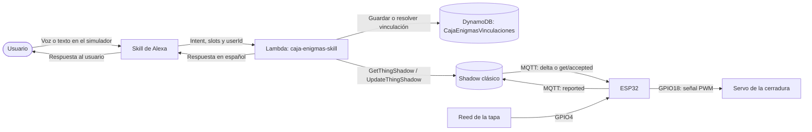
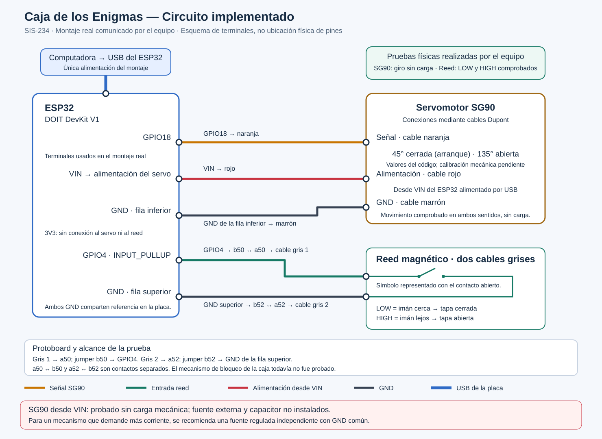
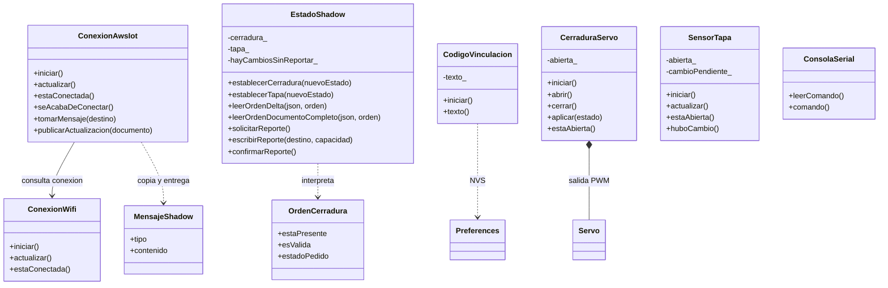
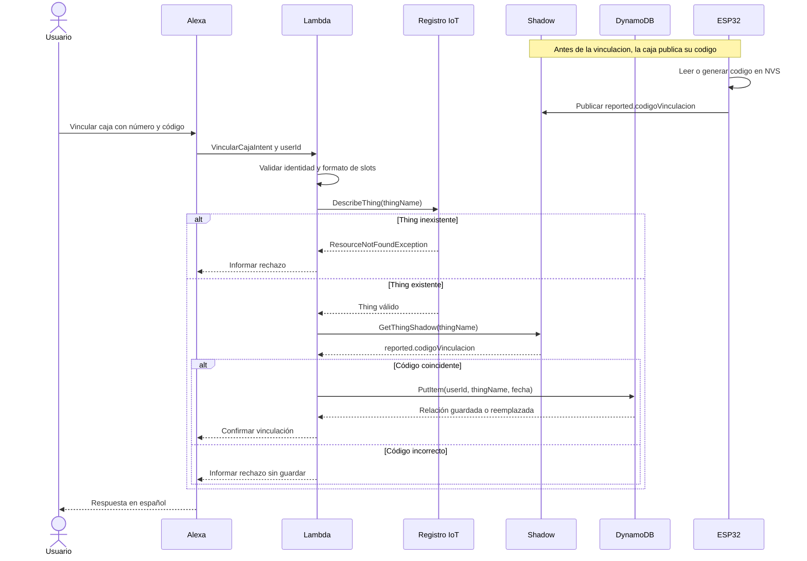
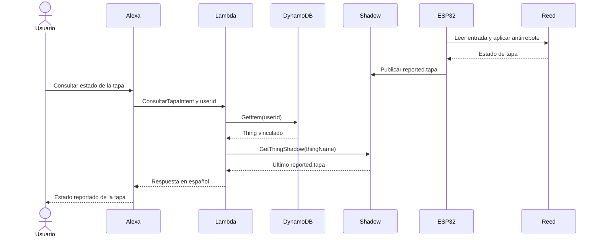
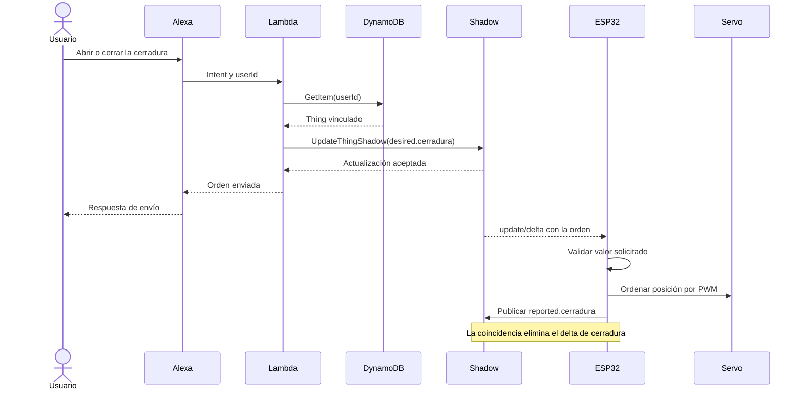
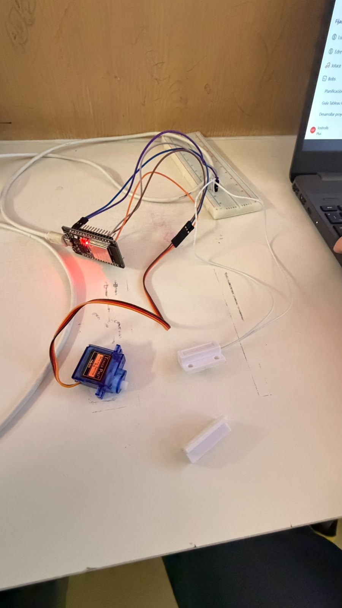
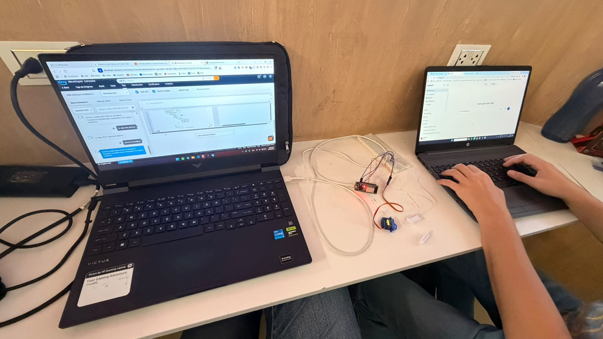

# Informe técnico — Práctica 3: Caja de los Enigmas

**Integración de un objeto inteligente con Alexa mediante MQTT y AWS IoT Core**

**Asignatura:** SIS-234 · Ingeniería de Sistemas

**Integrantes:** Santiago Torres, Adrián Mercado, Mateo Rojas y Lucía Escobar

**Fecha:** 10 de noviembre de 2026

Este informe presenta el módulo de cerradura por voz de la Caja de los Enigmas,
su implementación en ESP32 y AWS y las validaciones realizadas por el equipo.
Sigue la estructura del apartado 4.2 de la
[consigna original](docs/consigna/Práctica_3.md). La realización física es un
prototipo de mesa con servo y sensor magnético: representa el control de una
cerradura y la detección de tapa, sin un pestillo acoplado. Se distinguen los
resultados manuales, los automatizados y el alcance cualitativo de los RNF.

## 1. Caso de Uso y Requerimientos

### 1.1 Caso de uso *(Lucía, Santiago)*

En una actividad de Escape Room, el coordinador necesita controlar la apertura
de un compartimento y conocer si el participante lo abrió. La Caja de los
Enigmas aborda esa interacción mediante un módulo de cerradura inteligente:
Alexa recibe las instrucciones y consultas, mientras un ESP32 controla el
actuador y reporta el sensor a AWS IoT Core.

El SG90 representa el movimiento de trabar o destrabar; el reed y su imán
representan la apertura o cierre de la tapa. Ambos estados se mantienen
separados: destrabar no significa que una persona haya levantado la tapa.
Por ello, la skill ofrece consultas independientes de tapa y cerradura.

El prototipo entregado es el montaje de mesa mostrado en el apartado 3.6.
Se comprobó la integración de voz, servicios y componentes; la carcasa y el
pestillo de una caja real son una extensión mecánica del caso de uso.
El sistema identifica la caja de cada usuario mediante una vinculación
persistente, en lugar de asignar un Thing fijo a toda la skill. La placa
utilizada corresponde a `caja-enigmas-01`; cambiar la vinculación no exige
modificar el código del backend. Los acertijos y niveles del Escape Room
constituyen extensiones de este primer módulo.

### 1.2 Justificación del sensor y del actuador *(Santiago)*

El **Reed Switch** es adecuado para una tapa porque entrega una condición
discreta de contacto, relacionada con la presencia del imán. Se conecta entre
GPIO4 y GND con `INPUT_PULLUP`: LOW representa contacto cerrado y tapa cerrada;
HIGH representa contacto abierto y tapa abierta. No se necesita una medición
de distancia continua para resolver la consulta de apertura. El software
acepta un cambio después de 50 ms de estabilidad de la lectura.

El **servomotor SG90** permite solicitar dos posiciones para representar la
cerradura, mediante señal PWM en GPIO18. El firmware utiliza 45° para cerrada
y 135° para abierta; son posiciones ordenadas por software, sin medición
independiente del eje ni del pestillo. Esta elección permite observar una
acción mecánica reversible y coherente con el caso de uso, a diferencia de
una indicación luminosa. El ESP32 DOIT DevKit V1 integra la lectura digital,
la salida de control y la conexión WiFi de 2,4 GHz.

El montaje probado alimenta el ESP32 por USB y el servo desde VIN, con GND
común, sin fuente externa ni capacitor. Corresponde al ensayo de mesa sin
carga de pestillo documentado en el [circuito](docs/diagramas/circuito.svg).
La alternativa de fuente regulada externa de 5 V se conserva en la guía
como recomendación para una integración mecánica con mayor demanda. No se
presenta como parte del montaje ensayado ni se afirma haber medido tensión
o corriente. El diseño trabaja a baja tensión y no conmuta cargas de 220 V.

### 1.3 Requerimientos funcionales *(Lucía)*

Los RF1–RF9 de la consigna se concretan en los siguientes comportamientos.
La matriz del apartado 2.9 y las pruebas del apartado 4 relacionan cada uno
con su implementación y resultado.

| ID | Requerimiento en la Caja de los Enigmas | Criterio de aceptación |
|---|---|---|
| RF1 | Capturar el estado del reed como tapa abierta o cerrada. | La lectura lógica corresponde a la presencia/ausencia del imán que representa la tapa. |
| RF2 | Publicar el sensor y el estado lógico del actuador en `reported`. | El Shadow refleja los cambios y el firmware implementa un respaldo periódico completo. |
| RF3 | Recibir el delta, aplicar la orden al SG90 y confirmar. | Una orden válida modifica la salida del servo y se publica el nuevo `reported.cerradura`. |
| RF4 | Consultar la tapa desde Alexa. | La respuesta en español coincide con `reported.tapa` del Thing vinculado; si no existe el dato, se informa. |
| RF5 | Abrir y cerrar mediante Alexa. | La Lambda escribe solo `desired.cerradura` del Thing del usuario; la ESP32 aplica la orden. |
| RF6 | Consultar el estado del actuador. | Se informa el último `reported.cerradura` y se distingue una orden deseada todavía sin confirmar. |
| RF7 | Vincular una caja y conservar la asociación entre sesiones. | Número y código válidos permiten guardar la relación por usuario y recuperarla en otra sesión. |
| RF8 | Resolver el Thing asociado en cada solicitud. | Se consulta DynamoDB por `context.System.user.userId`; sin relación, se orienta para vincular. |
| RF9 | Validar existencia, cambiar y eliminar la vinculación. | Se comprueba `DescribeThing`; guardar otra caja reemplaza la relación y desvincular elimina solo la del usuario. |

El control de uso de la práctica pasa por Alexa y el Shadow. El firmware
conserva además comandos Serial de diagnóstico; esa diferencia respecto de
la exclusividad de voz indicada en la consigna se hace explícita en 4.8.
No se implementa una regla automática sensor → actuador.

### 1.4 Requerimientos no funcionales *(Lucía, Adrián)*

El proyecto definió criterios cuantitativos en su planificación. La validación
real conservada es cualitativa: el equipo no elaboró una bitácora de tiempos,
cantidades de ciclos o porcentajes. Los objetivos se presentan separados de
los resultados, sin convertir referencias de aceptación en mediciones.

| ID | Atributo y criterio definido | Resultado y alcance de la validación |
|---|---|---|
| RNF1 | Estabilidad: operación integrada de al menos 10 min, sin reinicios ni bloqueos. | El equipo observó funcionamiento estable; no registró la duración ni un conteo formal. |
| RNF2 | Exactitud discreta: cero discrepancias en el protocolo de 30 ciclos completos, comparando 60 estados y registrando distancia/orientación del imán. | Se reconocieron ambos estados manualmente; no se realizó una serie estadística registrada ni una medición de distancia. |
| RNF3 | Respuesta: máximo de 3 s, evaluado en diez órdenes alternadas desde el fin de la orden hasta el inicio del movimiento. | Se observó la respuesta funcional; no se obtuvo un máximo o promedio cronometrado. |
| RNF4 | Reporte: cambio de estado en hasta 1 s y respaldo completo de 60 s. | Parámetros y eventos verificados en el código; sincronización observada sin una serie temporal instrumental. |
| RNF5 | Recuperar automáticamente WiFi/MQTT y sincronizar el estado solicitado tras reconectar. El protocolo planificaba tres cortes WiFi y tres de Internet. | El equipo confirmó la reconexión automática al restablecer la red, sin contar ni cronometrar cortes. No se atribuye un ensayo específico con una orden emitida fuera de línea. |
| RNF6 | Seguridad y mantenibilidad: TLS mutuo, secretos fuera de Git, permisos delimitados y código modular. | Controles revisados en las fuentes y configuraciones; validaciones de identidad, SSML y logs cubiertas por la suite local. |

Una apertura es un evento que interesa reportar inmediatamente; el respaldo
de 60 s mantiene el documento en reposo sin publicar en cada vuelta del bucle.
La referencia teórica de 1 440 respaldos por día corresponde solo a esos
intervalos, no a un conteo experimental ni al consumo total de AWS.

## 2. Análisis y Diseño

### 2.1 Arquitectura del sistema



Alexa utiliza la Lambda como backend. La Lambda resuelve el Thing mediante
DynamoDB y consulta o modifica su Shadow. El ESP32 se comunica con IoT Core
mediante MQTT sobre TLS mutuo y atiende sus temas del Shadow.

El Shadow conserva el último estado reportado cuando el dispositivo está
desconectado. Por ello, una consulta de estado no demuestra por sí sola que
la caja esté conectada en ese instante. Una orden puede quedar sin aplicar
hasta la reconexión.

### 2.2 Diagrama de circuito



| Conexión | Realización documentada |
|---|---|
| ESP32 | USB de la computadora. |
| Señal del SG90 | Cable naranja a GPIO18. |
| Alimentación del SG90 | Cable rojo a VIN; cable marrón a GND inferior de la placa. |
| Reed | Contacto entre GPIO4 y GND superior; `INPUT_PULLUP` interno. |
| Protoboard del reed | Cable 1 a a50 y puente b50 a GPIO4; cable 2 a a52 y puente b52 a GND. |
| Fuente externa / capacitor | No instalados en el prototipo probado. |

El SVG de Santiago representa terminales eléctricos, no la ubicación física
de los pines. Ambos GND pertenecen a la misma referencia de la placa. La
fotografía del apartado 3.6 y la confirmación del equipo corresponden a este
montaje. Se comprobó LOW con imán cerca y HIGH con imán lejos; el SG90 se
movió sin carga de pestillo. Los ángulos del código no se presentan como
una calibración de un mecanismo de bloqueo real.

### 2.3 Diagrama de clases del objeto inteligente



Las siete clases de la aplicación están definidas en
[firmware/include](firmware/include). `OrdenCerradura` es una estructura de
`EstadoShadow.h`; `MensajeShadow` es una estructura anidada de `ConexionAwsIot`.
`Servo` y `Preferences` pertenecen a las bibliotecas utilizadas.

[main.cpp](firmware/src/main.cpp) instancia y coordina los objetos desde
`setup()` y `loop()`; no es una clase adicional. Conecta el estado y las
órdenes con el servo, consume los cambios del sensor y programa los reportes.
`EstadoShadow` no depende de Arduino y puede probarse de forma nativa.

### 2.4 Diagrama de clases de la función Lambda

El backend separa manejadores de solicitudes y servicios de acceso a datos.
Cada manejador implementa `can_handle` y `handle`; `crear_skill` compone sus
instancias y las registra en `SkillBuilder`.

```mermaid
classDiagram
    class SkillBuilder
    class AbstractRequestHandler
    class AbstractExceptionHandler
    class LaunchRequestHandler
    class VincularCajaIntentHandler
    class DesvincularCajaIntentHandler
    class ConsultarTapaIntentHandler
    class ConsultarCerraduraIntentHandler
    class CambiarCerraduraIntentHandler
    class AbrirCerraduraIntentHandler
    class CerrarCerraduraIntentHandler
    class HelpIntentHandler
    class CancelOrStopIntentHandler
    class FallbackIntentHandler
    class NavigateHomeIntentHandler
    class SessionEndedRequestHandler
    class GlobalExceptionHandler
    class RepositorioVinculaciones {
        +obtener(user_id)
        +guardar(user_id, thing_name)
        +eliminar(user_id)
    }
    class ServicioRegistro {
        +existe_thing(thing_name)
    }
    class ServicioShadow {
        +leer_estado(thing_name)
        +leer_reported(thing_name)
        +pedir_cerradura(thing_name, estado)
    }
    AbstractRequestHandler <|-- LaunchRequestHandler
    AbstractRequestHandler <|-- VincularCajaIntentHandler
    AbstractRequestHandler <|-- DesvincularCajaIntentHandler
    AbstractRequestHandler <|-- ConsultarTapaIntentHandler
    AbstractRequestHandler <|-- ConsultarCerraduraIntentHandler
    AbstractRequestHandler <|-- CambiarCerraduraIntentHandler
    CambiarCerraduraIntentHandler <|-- AbrirCerraduraIntentHandler
    CambiarCerraduraIntentHandler <|-- CerrarCerraduraIntentHandler
    AbstractRequestHandler <|-- HelpIntentHandler
    AbstractRequestHandler <|-- CancelOrStopIntentHandler
    AbstractRequestHandler <|-- FallbackIntentHandler
    CancelOrStopIntentHandler <|-- NavigateHomeIntentHandler
    AbstractRequestHandler <|-- SessionEndedRequestHandler
    AbstractExceptionHandler <|-- GlobalExceptionHandler
    SkillBuilder o-- AbstractRequestHandler
    SkillBuilder o-- GlobalExceptionHandler
    LaunchRequestHandler --> RepositorioVinculaciones
    VincularCajaIntentHandler --> RepositorioVinculaciones
    VincularCajaIntentHandler --> ServicioRegistro
    VincularCajaIntentHandler --> ServicioShadow
    DesvincularCajaIntentHandler --> RepositorioVinculaciones
    ConsultarTapaIntentHandler --> RepositorioVinculaciones
    ConsultarTapaIntentHandler --> ServicioShadow
    ConsultarCerraduraIntentHandler --> RepositorioVinculaciones
    ConsultarCerraduraIntentHandler --> ServicioShadow
    CambiarCerraduraIntentHandler --> RepositorioVinculaciones
    CambiarCerraduraIntentHandler --> ServicioShadow
```



El diagrama reutiliza el aporte técnico de Mateo y se contrasta con
[lambda_function.py](lambda/lambda_function.py),
[manejadores](lambda/manejadores) y [servicios](lambda/servicios).
La clase común de apertura/cierre evita duplicar la resolución del usuario
y el envío de la orden. `NavigateHomeIntentHandler` hereda el cierre de
`CancelOrStopIntentHandler`; `SessionEndedRequestHandler` devuelve respuesta
vacía. La identidad se extrae con la función `obtener_user_id`, no con otra
clase ni con almacenamiento global de usuarios.

### 2.5 Diagramas de secuencia

#### Vinculación de un Thing



#### Consulta del sensor de tapa



El reporte del sensor ocurre por evento y de forma periódica. La consulta
de Alexa recupera el último valor almacenado en el Shadow; no solicita una
medición nueva al sensor en ese instante. Esta secuencia representa el
diseño implementado. La consulta y la conmutación del reed fueron
confirmadas manualmente por el equipo en el prototipo.

#### Comando sobre la cerradura y confirmación



La Lambda responde al envío sin esperar al movimiento físico. La
confirmación del firmware y la observación mecánica se verifican aparte.
El SG90 no aporta en este diseño una medición de posición del pestillo.

### 2.6 Especificación del documento Shadow

Se utiliza el **Shadow clásico, sin nombre**, de cada Thing. Sus atributos
están definidos en [contratos.md](docs/contratos.md).

| Atributo | Sección | Tipo y valores | Responsable |
|---|---|---|---|
| `cerradura` | `desired` | String: `abierta` o `cerrada`. | Lambda, por comandos de Alexa. |
| `cerradura` | `reported` | String: `abierta` o `cerrada`. | ESP32, tras ordenar la posición al servo. |
| `tapa` | `reported` | String: `abierta` o `cerrada`. | ESP32, según lectura con antirrebote. |
| `codigoVinculacion` | `reported` | String de cuatro dígitos, incluidos ceros iniciales. | ESP32; generación inicial y conservación en NVS. |
| `firmware` | `reported` | String de versión; en el ensayo, `0.2.0`. | ESP32. |

Ejemplo ilustrativo con una orden sin confirmar; el código mostrado es ficticio:

```json
{
  "state": {
    "desired": {"cerradura": "abierta"},
    "reported": {
      "cerradura": "cerrada",
      "tapa": "cerrada",
      "codigoVinculacion": "0000",
      "firmware": "0.2.0"
    },
    "delta": {"cerradura": "abierta"}
  }
}
```

El servicio calcula `delta` al comparar `desired` y `reported`. El ESP32
ignora atributos desconocidos y rechaza valores de cerradura inválidos.
Al recibir un valor inválido conserva su salida y solicita reportar el
estado que mantiene. La aplicación del ESP32 no borra `desired`.

Prefijo MQTT: `$aws/things/<thingName>/shadow/`.

| Sufijo | Dirección | Función |
|---|---|---|
| `update` | ESP32 → IoT Core | Publicación de `state.reported`. |
| `update/delta` | IoT Core → ESP32 | Recepción de cambios sin reportar. |
| `get` | ESP32 → IoT Core | Solicitud del documento completo al conectar. |
| `get/accepted` | IoT Core → ESP32 | Documento solicitado, incluido `state.delta` cuando existe. |
| `get/rejected`, `update/rejected` | IoT Core → ESP32 | Diagnóstico de solicitudes rechazadas. |

### 2.7 Diseño del mecanismo de vinculación

El número de caja se valida entre 1 y 99 y se combina con el prefijo para
formar un nombre de dos dígitos, como `caja-enigmas-01`. El código es una
cadena de cuatro dígitos ASCII. La Lambda valida el formato, comprueba
`DescribeThing` y compara el código con el del Shadow antes de guardar.

La tabla `CajaEnigmasVinculaciones` tiene clave de partición `userId`
String y no tiene clave de ordenación. Cada ítem contiene `thingName` y
`fechaVinculacion`, también String; la fecha usa ISO-8601 UTC. Las consultas
y órdenes recuperan la relación con `ConsistentRead=True` en cada petición
que necesita una caja previamente vinculada.

`PutItem` reemplaza la relación del mismo usuario para cambiar de caja.
`DeleteItem` permite desvincular sin borrar el Thing. El contrato establece
una caja por usuario; no impone exclusividad del Thing entre usuarios.
La implementación separa esta asociación del identificador de sesión.

El código se conserva mediante NVS cuando su lectura o guardado termina
correctamente. El firmware informa por Serial si no puede persistirlo.
El espacio de cuatro dígitos es una identificación práctica del prototipo;
no se presenta como un mecanismo de autenticación robusto para producción.

### 2.8 Diseño de la skill de Alexa

La skill es Custom, con idioma **Spanish (US), `es-US`**, nombre de
invocación **«caja de enigmas»** y pruebas mediante Alexa Developer Console.
El [modelo exportado](config/alexa/modelo-interaccion.es-US.json) contiene
11 intents: seis propios y cinco integrados, con 48 frases propias.

| Intent | Slots | Ejemplos y efecto |
|---|---|---|
| `VincularCajaIntent` | `numeroCaja`: `AMAZON.NUMBER`; `codigo`: `AMAZON.FOUR_DIGIT_NUMBER`. | «vincula mi caja … con el código …», «registra mi caja»; guarda o cambia la relación. |
| `DesvincularCajaIntent` | Ninguno. | «desvincula mi caja», «olvida mi caja»; elimina la relación. |
| `ConsultarTapaIntent` | Ninguno. | «cómo está la tapa», «consulta la tapa»; lee `reported.tapa`. |
| `ConsultarCerraduraIntent` | Ninguno. | «cómo está la cerradura», «consulta la cerradura»; compara `reported` y `desired`. |
| `AbrirCerraduraIntent` | Ninguno. | «abre la cerradura», «destraba la caja»; solicita `abierta`. |
| `CerrarCerraduraIntent` | Ninguno. | «cierra la cerradura», «traba la caja»; solicita `cerrada`. |
| `AMAZON.HelpIntent` | Ninguno. | Explica las funciones disponibles. |
| `AMAZON.CancelIntent`, `AMAZON.StopIntent` | Ninguno. | Finalizan la conversación. |
| `AMAZON.FallbackIntent` | Ninguno. | Orienta ante una petición no reconocida. |
| `AMAZON.NavigateHomeIntent` | Ninguno. | El manejador finaliza la sesión si recibe el intent. |

Los dos slots de vinculación son obligatorios. El modelo establece
`delegationStrategy: ALWAYS` y prompts para solicitar el número de caja y
el código cuando falten. `LaunchRequest` y `SessionEndedRequest` son tipos
de solicitud y tienen manejadores propios.

### 2.9 Matriz de trazabilidad

Las referencias PF/PN/PS identifican los escenarios del apartado 4 y del
[plan de pruebas](docs/PLAN_PRUEBAS.md). Una aprobación manual reportada,
un test con mocks y una medición instrumental tienen alcances diferentes.

| Requisito | Diseño e implementación | Prueba | Resultado documentado |
|---|---|---|---|
| RF1 | `SensorTapa`, GPIO4, antirrebote. | PF01 / PN02. | Aprobado manual: reconocimiento de los estados representados por el imán. |
| RF2 | `EstadoShadow` y programación de reportes en `main.cpp`. | PF02 / PN04. | Aprobado manual: sincronización; temporización configurada contrastada con el código. |
| RF3 | Interpretación del delta, `CerraduraServo` y publicación del estado. | PF03. | Aprobado manual; estados de apertura/cierre observados en el Shadow. |
| RF4 | `ConsultarTapaIntentHandler` y `ServicioShadow`. | PF04. | Aprobado manual y tests de estados del sensor. |
| RF5 | Manejadores de abrir/cerrar y `pedir_cerradura`. | PF05 / PF06. | Aprobado manual; tests de payload y observaciones de comunicación. |
| RF6 | Consulta conjunta de `desired` y `reported`. | PF07. | Aprobado manual; tests de estado reportado y orden sin confirmar. |
| RF7 | Código en NVS y relación persistente en DynamoDB. | PF08 / PF09. | Aprobado manual; relación visible en captura y persistencia simulada en tests. |
| RF8 | `obtener_user_id` y lectura consistente por solicitud. | PF10. | Aprobado manual; identidad y dos usuarios simulados cubiertos automáticamente. |
| RF9 | `DescribeThing`, reemplazo y eliminación de la relación. | PF11 / PF12. | Aprobado manual; inexistencia, rechazos, cambio y aislamiento cubiertos con mocks. |
| RNF1 | Supervisión de conexiones y bucle principal. | PN01. | Estabilidad observada cualitativamente, sin duración registrada. |
| RNF2 | Entrada discreta y antirrebote de 50 ms. | PN02. | Estados reconocidos; sin estadística de repetibilidad ni distancia medida. |
| RNF3 | Recorrido Alexa–Lambda–Shadow–ESP32–SG90. | PN03. | Respuesta funcional observada; no se obtuvo latencia instrumental. |
| RNF4 | Eventos y respaldo `IntervaloReportePeriodicoMs=60000`. | PN04. | Código verificado y sincronización observada; sin serie temporal de publicaciones. |
| RNF5 | Reintentos WiFi/MQTT y lectura del documento al conectar. | PN05. | Reconexión automática confirmada; aplicación de delta al reconectar implementada, sin ensayo dirigido documentado con una orden fuera de línea. |
| RNF6 | TLS mutuo, políticas, plantillas y exclusión de secretos. | PS01. | Revisión de fuentes y configuración; validaciones del backend aprobadas en tests. |

## 3. Desarrollo e Implementación

### 3.1 Estructura del código del objeto inteligente

El [proyecto PlatformIO](firmware/platformio.ini) fija `espressif32@7.0.1`,
Arduino ESP32 `2.0.17` y la placa `esp32doit-devkit-v1`. Usa MQTT `2.5.2`,
ArduinoJson `7.2.1` y ESP32Servo `3.0.6`; el programa integrado es `0.2.0`.

| Archivo / clase | Responsabilidad |
|---|---|
| [main.cpp](firmware/src/main.cpp) | Componer componentes, interpretar órdenes y programar reportes. |
| [ConexionWifi](firmware/src/ConexionWifi.cpp) | Asociación en modo estación y reintentos programados. |
| [ConexionAwsIot](firmware/src/ConexionAwsIot.cpp) | Hora NTP, TLS mutuo, MQTT, suscripciones y copia de mensajes. |
| [EstadoShadow](firmware/src/EstadoShadow.cpp) | Validar JSON, conservar estados y construir `reported`. |
| [CodigoVinculacion](firmware/src/CodigoVinculacion.cpp) | Leer/generar cuatro dígitos y conservarlos mediante NVS. |
| [CerraduraServo](firmware/src/CerraduraServo.cpp) | Convertir apertura/cierre en posiciones PWM. |
| [SensorTapa](firmware/src/SensorTapa.cpp) | Lectura digital con antirrebote y aviso consumible de cambio. |
| [ConsolaSerial](firmware/src/ConsolaSerial.cpp) | Recibir líneas de diagnóstico con longitud y trabajo por vuelta acotados. |

El bucle coordina las clases sin publicar desde el callback MQTT:

```cpp
void loop() {
    conexionWifi.actualizar();
    conexionAws.actualizar();

    if (conexionAws.seAcabaDeConectar()) {
        estadoShadow.solicitarReporte();
    }
    while (conexionAws.tomarMensaje(mensajeRecibido)) {
        procesarMensaje(mensajeRecibido);
    }
    actualizarTapa();
    atenderConsola();
    solicitarReportePeriodico();
    publicarReporteSiHaceFalta();
}
```

El callback conserva el último documento completo y el último delta recibidos;
el bucle los retira y procesa antes de atender sensor y reportes. Al conectar,
se solicita el Shadow completo. Los cambios y el respaldo periódico solicitan
un reporte, que se confirma localmente solo si la publicación tiene éxito.
Los reintentos se programan por intervalos; las operaciones TCP/TLS/MQTT
tienen esperas configuradas y no se describen como completamente no bloqueantes.

El sensor acepta una transición después de estabilidad de la lectura:

```cpp
void SensorTapa::actualizar() {
    const bool lecturaAbierta = digitalRead(pin_) == HIGH;
    const unsigned long ahoraMs = millis();

    if (lecturaAbierta != ultimaLecturaAbierta_) {
        ultimaLecturaAbierta_ = lecturaAbierta;
        ultimoCambioLecturaMs_ = ahoraMs;
    }

    if (ultimaLecturaAbierta_ != abierta_ &&
        ahoraMs - ultimoCambioLecturaMs_ >= AntirreboteMs) {
        abierta_ = ultimaLecturaAbierta_;
        cambioPendiente_ = true;
    }
}
```

`huboCambio()` devuelve el aviso una vez, lo que evita publicar repetidamente
el mismo evento. Los [pines y ángulos](firmware/include/ConfiguracionHardware.h)
se separan de las configuraciones privadas. El servo arranca ordenando cerrar
y mantiene PWM; el código no desconecta automáticamente la salida con `detach()`.
`reported.cerradura` representa la posición ordenada, no una realimentación
de la posición física del pestillo.

### 3.2 Estructura del código de la función Lambda

[lambda_function.py](lambda/lambda_function.py) construye y reutiliza clientes
AWS y compone la skill mediante `crear_skill`. El handler publicado es
`lambda_function.lambda_handler`.

| Componente | Función dentro del sistema |
|---|---|
| [manejadores](lambda/manejadores) | Seleccionar y atender bienvenida, vinculación, consultas, órdenes y sesión. |
| [RepositorioVinculaciones](lambda/servicios/repositorio_vinculaciones.py) | Obtener, guardar/reemplazar y eliminar la relación del usuario. |
| [ServicioRegistro](lambda/servicios/servicio_registro.py) | Comprobar existencia con `DescribeThing`; solo un recurso inexistente retorna `False`. |
| [ServicioShadow](lambda/servicios/servicio_shadow.py) | Leer el Shadow clásico y escribir la orden deseada. |
| [identidad.py](lambda/manejadores/identidad.py) | Recuperar defensivamente `context.System.user.userId`, sin usar el usuario de sesión como alternativa. |
| [textos.py](lambda/textos.py) | Centralizar respuestas compartidas en español. |
| [GlobalExceptionHandler](lambda/manejadores/errores.py) | Responder con un mensaje genérico y registrar categorías/operaciones permitidas. |

La caja se resuelve por petición con lectura consistente:

```python
def obtener(self, user_id):
    respuesta = self.tabla.get_item(
        Key={"userId": user_id},
        ConsistentRead=True
    )
    return respuesta.get("Item")
```

Esto permite observar el reemplazo o eliminación recientes de la vinculación,
sin conservar una caja global en memoria. Los servicios reciben sus clientes
por constructor y los manejadores reciben esos servicios, facilitando las
pruebas con dependencias sustituidas.

El servicio de comandos limita la escritura a un atributo de `desired`:

```python
def pedir_cerradura(self, thing_name, estado):
    if estado not in ("abierta", "cerrada"):
        raise ValueError(
            "El estado debe ser 'abierta' o 'cerrada'"
        )

    documento = {
        "state": {
            "desired": {
                "cerradura": estado
            }
        }
    }

    respuesta = self.cliente_iot.update_thing_shadow(
        thingName=thing_name,
        payload=json.dumps(documento).encode("utf-8")
    )

    return self._leer_documento(respuesta)
```

La respuesta de voz anuncia el envío; la ESP32 realiza la acción y reporta su
estado. `leer_estado` obtiene `desired` y `reported` en una sola lectura,
evitando comparar versiones distintas. `_leer_documento` consume y cierra el
payload incluso si el JSON falla. Los errores se propagan al manejador global,
que no registra eventos completos, códigos, tokens ni identificadores de usuario.
La bienvenida escapa XML al introducir texto dinámico en SSML.

La auditoría histórica y el empaquetado se conservan como documentación
complementaria en [backend-lambda.md](docs/backend-lambda.md).

### 3.3 Configuración de AWS IoT Core

Los recursos del proyecto se gestionan desde la consola y sus
configuraciones se conservan en [config/aws](config/aws). La revisión del
10/11 comprobó los certificados activos y sus políticas asociadas para
los Things revisados. El ensayo funcional se limitó a la caja 01.

La [política de IoT](config/aws/politica-iot.json) restringe la conexión al
client ID del Thing asociado al certificado y sus temas de Shadow.
La condición `iot:Connection.Thing.IsAttached` exige la asociación del
certificado con el Thing. Se conceden `iot:Connect`, `iot:Publish`,
`iot:Receive` e `iot:Subscribe` para ese ámbito.

El ESP32 utiliza el endpoint ATS de la cuenta, puerto 8883, CA pública de
Amazon y certificado y clave propios. Sin una hora válida se aplaza TLS;
el firmware solicita hora por NTP antes de intentar la conexión segura.
El procedimiento está en [configuracion-aws-iot.md](docs/configuracion-aws-iot.md).

Las configuraciones WiFi y de certificados se mantienen en archivos locales
ignorados por Git. Se entregan únicamente las plantillas
[WiFi](firmware/include/ConfiguracionWifi.ejemplo.h) y
[AWS](firmware/include/ConfiguracionAws.ejemplo.h). Los ejemplos de este
informe no contienen credenciales reales ni el código de vinculación usado.

### 3.4 Configuración de Lambda, DynamoDB y rol IAM

La lectura de configuración realizada el 10/11 verificó:

| Elemento | Valor observado |
|---|---|
| Función y región | `caja-enigmas-skill`, `us-east-1`. |
| Runtime y arquitectura | Python 3.12, `x86_64`. |
| Handler | `lambda_function.lambda_handler`. |
| Estado de función y actualización | `Active` y `Successful`. |
| Memoria y timeout | 128 MB y 3 s. |
| Rol | `caja-enigmas-lambda-rol`. |
| Tabla | `CajaEnigmasVinculaciones`, `ACTIVE`, `userId` String, on-demand. |
| Variables | `TABLA_VINCULACIONES`, `PREFIJO_THING` e `IOT_ENDPOINT`, coherentes con tabla, nombres y endpoint ATS. |
| Disparador | Alexa Skills Kit, restringido al Skill ID de la skill utilizada. |
| Logs | `/aws/lambda/caja-enigmas-skill`, con `AWSLambdaBasicExecutionRole` adjunta al rol. |

El paquete desplegado tiene SHA-256
`60cf2ee785a03375b7b365eef36f80bb4e60615143376d3f1d3c5ecaa2b46bd7`,
coincidente con el paquete definitivo documentado por Mateo. La configuración
indicaba actualización `2026-11-10T01:33:50Z`, coherente con la ejecución
del paquete definitivo registrada en las evidencias.

Las dependencias verificadas del paquete están fijadas en
[requirements-despliegue.txt](lambda/requirements-despliegue.txt).
El procedimiento y las comprobaciones del ZIP se conservan en el
[registro del paquete](docs/backend-lambda.md#3-registro-del-paquete-definitivo); los ZIP generados no se versionan.

| Permiso del rol | Recurso y justificación |
|---|---|
| `iot:DescribeThing` | Things `caja-enigmas-*`; comprobar existencia antes de vincular. |
| `iot:GetThingShadow` | Los mismos Things; leer código, tapa, cerradura y orden sin confirmar. |
| `iot:UpdateThingShadow` | Los mismos Things; solicitar apertura o cierre. |
| `dynamodb:GetItem`, `PutItem`, `DeleteItem` | Tabla de vinculaciones; resolver, guardar/reemplazar y eliminar relaciones. |
| Permisos de CloudWatch de `AWSLambdaBasicExecutionRole` | Crear y escribir logs. La política administrada utiliza recursos amplios; para producción conviene acotarlos al grupo correspondiente. |

La confianza del rol permite asumirlo al servicio `lambda.amazonaws.com`.
La [política de acceso a datos](config/aws/politica-rol-lambda.json) delimita
los Things del proyecto y la tabla. El permiso de invocación de Alexa es
una política de la función, distinta de los permisos del rol de ejecución.

### 3.5 Configuración de Alexa

La revisión por ASK CLI consultó el manifiesto y el modelo en desarrollo.
El endpoint apuntaba a la función `caja-enigmas-skill` en `us-east-1`, sin
versión o alias en el ARN. El modelo coincidía con el JSON del repositorio
y la consulta de habilitación devolvió `204` para la cuenta configurada.
El Skill ID coincidía con la condición del disparador de Lambda.

Las pruebas funcionales se realizaron desde el simulador de Alexa Developer
Console, en `Development` y `es-US`. Las respuestas comunicadas por el usuario
y los estados observados se registran en la sección 4.2.

### 3.6 Montaje

El prototipo se realizó sobre una mesa con ESP32 DOIT DevKit V1, SG90, sensor
magnético de dos contactos, imán, protoboard, cables Dupont y USB de datos.
El equipo confirmó que es el montaje final de esta práctica, basado en el
SVG del apartado 2.2. No incorpora carcasa ni pestillo acoplado al servo.



La computadora alimenta la placa por USB y el SG90 recibe alimentación desde
VIN. La señal llega por GPIO18 y el reed conecta GPIO4 con GND. Los dos
contactos del sensor se mantienen separados en protoboard; la proximidad del
imán representa tapa cerrada. Se ensayó el giro del servo sin carga de bloqueo,
con 45° y 135° como consignas del firmware, sin medición angular instrumental.

Durante la integración se cargó el firmware `0.2.0` por `COM5`. Las órdenes de
Alexa actualizaron `desired` y la ESP32 confirmó su estado en `reported`.
La [guía de montaje](docs/GUIA_MONTAJE.md) conserva el cableado y el uso de
diagnósticos; la alternativa de fuente externa se distingue del montaje
fotografiado. La realización valida el módulo electrónico del caso de uso,
sin atribuirle capacidad de bloqueo mecánico o funcionamiento bajo carga.

## 4. Pruebas y Validaciones

### 4.1 Plan de pruebas y procedimiento

Las comprobaciones se realizaron durante el desarrollo y la integración.
El equipo confirmó RF1–RF9, las 48 frases del modelo y la recuperación
automática de la conexión al restablecer la red. Se contrastaron con el
código, el modelo exportado, las fotografías y las capturas de AWS.

No se elaboró una bitácora con cantidades de ejecuciones, duración de las
sesiones, tiempos cronometrados ni porcentajes de éxito. Esta característica
del método no invalida la confirmación manual, pero delimita los resultados:
no se atribuyen mediciones a una observación cualitativa. Los procedimientos
de la matriz describen cómo se verifica cada escenario y no reconstruyen
repeticiones o secuencias cronológicas que no fueron registradas.

| Tipo de resultado | Significado |
|---|---|
| **Aprobado — validación manual reportada por el equipo** | Comprobación funcional confirmada por sus integrantes; las imágenes complementan esa declaración sin constituir una bitácora individual de cada ensayo. |
| **Aprobado (automatizado)** | Prueba local ejecutada con salida verificable y alcance limitado a los componentes ejercitados. |
| **Verificado cualitativamente** | Comportamiento observado sin una medición numérica que acredite un umbral. |
| **Verificado en el código** | Parámetro o mecanismo contrastado directamente con las fuentes; no equivale a una medición experimental. |

La prueba de comunicación identificada utilizó la caja 01, firmware `0.2.0`,
la skill en `Development` y el idioma `es-US`. El ensayo de mesa está
documentado por las fotografías de los apartados 3.6 y 4.2; las capturas
históricas de AWS se catalogan con su alcance en el apartado 8.2.

#### Pruebas automatizadas locales

La suite de [lambda/tests](lambda/tests) se ejecutó con **Python 3.13.15 en
Windows** y las versiones de
[requirements-despliegue.txt](lambda/requirements-despliegue.txt):
`ask-sdk-core 1.19.0`, `ask-sdk-model 1.82.0` y `boto3/botocore 1.43.126`.
Se bloquearon adicionalmente las conexiones de red durante toda la suite.

```text
Pruebas ejecutadas: 76
Fallos: 0
Errores: 0
Omitidas: 0
Intentos de conexión de red: 0
```

La suite corresponde a `python -m unittest discover -s lambda/tests -v`.
[apoyo.py](lambda/tests/apoyo.py) sustituye los clientes AWS antes de importar
el punto de entrada. Los flujos ejercitan el dispatcher y la serialización
reales del SDK de Alexa, con servicios o clientes boto3 simulados.

| Verificación | Cobertura y resultado |
|---|---|
| Backend: 76 pruebas | **Aprobado (automatizado)**: manejadores, servicios, persistencia simulada, dos usuarios, validaciones, estados sin confirmar y errores. No invoca AWS, Alexa real ni el dispositivo. |
| Seguridad del backend — PS01 / RNF6 | **Aprobado (automatizado)** para identidad, códigos, SSML y logs propios, según [test_auditoria.py](lambda/tests/test_auditoria.py) y [test_sesion_y_errores.py](lambda/tests/test_sesion_y_errores.py). |
| Lógica nativa de `EstadoShadow` | Se revisaron los 17 casos definidos en el [archivo de pruebas](firmware/test/test_estado_shadow/test_estado_shadow.cpp): lectura de órdenes, JSON y cambios sin reportar. La reproducción local de esta revisión no produjo una nueva ejecución por limitaciones del compilador del entorno; no se presenta esa revisión estática como una aprobación nueva. |

El [registro técnico del backend](docs/backend-lambda.md) conserva la
ejecución histórica de 76 pruebas con Python 3.12.10 y la validación aislada
del paquete. La ejecución actual con Python 3.13.15 se identifica por separado;
no sustituye una prueba nueva del runtime de AWS. Las suites locales no
constituyen evidencia de reconocimiento de voz ni de comportamiento físico.

### 4.2 Pruebas funcionales y frases de la skill

La siguiente matriz reúne los escenarios confirmados por el equipo. Los
identificadores PF permiten relacionarlos con el diseño y con el
[plan de frases](docs/PLAN_PRUEBAS.md).

| ID | Prueba | Procedimiento | Resultado esperado | Resultado obtenido | Estado |
|---|---|---|---|---|---|
| RF1 — PF01 | Detectar apertura/cierre representados por el imán. | Colocar y retirar el imán; comparar la lectura de la ESP32 con la condición del contacto. | Identificar tapa abierta y cerrada. | Detección correcta reportada por el equipo; el circuito documenta LOW cerca y HIGH lejos. Se trabajó con la representación de tapa del montaje de mesa. | Aprobado — validación manual reportada por el equipo |
| RF2 — PF02 | Sincronizar sensor y actuador con `reported`. | Contrastar los atributos del Shadow con el reed y la posición lógica del servo; revisar los eventos y respaldo del código. | Reflejar tapa y cerradura de forma coherente. | El equipo confirmó la sincronización. La captura del Shadow y las observaciones de apertura/cierre la complementan, sin medir intervalos. | Aprobado — validación manual reportada por el equipo |
| RF3 — PF03 | Aplicar una orden y confirmar su estado. | Enviar la orden por Alexa; comprobar `desired`, recepción en la ESP32, movimiento del SG90 y `reported`. | Ejecutar la acción y confirmar el estado. | Funcionamiento integrado confirmado. Se documentaron estados coincidentes del Shadow; el movimiento físico se sustenta en el reporte del equipo y el contexto fotografiado. | Aprobado — validación manual reportada por el equipo |
| RF4 — PF04 | Consultar el sensor mediante Alexa. | Usar «cómo está la tapa» y contrastar la respuesta con `reported.tapa` del Thing vinculado. | Responder en español abierta/cerrada o reconocer que no hay dato. | Consulta funcional confirmada; las respuestas de ambas condiciones y dato ausente también están cubiertas por tests. | Aprobado — validación manual reportada por el equipo |
| RF5 — PF05 / PF06 | Abrir y cerrar mediante Alexa. | Solicitar «abre la cerradura» y «cierra la cerradura»; observar el servo y el cambio de `desired`. | El SG90 realiza la acción solicitada y la Lambda anuncia el envío. | Control del actuador confirmado. En el ensayo de comunicación ambas órdenes terminaron con `desired` y `reported` coincidentes. No se cronometró la acción. | Aprobado — validación manual reportada por el equipo |
| RF6 — PF07 | Consultar el estado de la cerradura. | Solicitar «cómo está la cerradura» y contrastar lo reportado y el aviso de orden sin confirmar. | Informar el último reporte y distinguirlo de una solicitud aún no aplicada. | Consulta confirmada por el equipo; estados reportados, ausentes y deseados distintos cubiertos por tests. | Aprobado — validación manual reportada por el equipo |
| RF7 — PF08 / PF09 | Vincular y conservar la relación entre sesiones. | Vincular con número y código válidos; comprobar DynamoDB y la conservación de la caja al iniciar otra sesión. | Persistir la relación y recuperarla por el mismo usuario. | Vinculación persistente confirmada. La captura de DynamoDB muestra una relación almacenada; la conservación entre sesiones se sustenta en la validación manual reportada. | Aprobado — validación manual reportada por el equipo |
| RF8 — PF10 | Resolver la caja por usuario y orientar sin vinculación. | Realizar consultas/comandos con relación guardada y considerar una solicitud sin vinculación. | Resolver por `context.System.user.userId` y orientar si no hay caja. | Comportamiento confirmado por el equipo. Los tests comprueban además identidad ausente y dos usuarios simulados, sin atribuir una prueba instrumental a dos cuentas reales. | Aprobado — validación manual reportada por el equipo |
| RF9 — PF11 / PF12 | Validar, cambiar y eliminar la vinculación. | Contrastar rechazo de Thing inexistente, vinculación de otra caja y «desvincula mi caja» con DynamoDB. | Aceptar Things existentes, reemplazar la relación y eliminarla sin borrar el Thing. | Funcionalidad general confirmada; inexistencia, rechazo, sustitución y eliminación aislada también se comprobaron con mocks. | Aprobado — validación manual reportada por el equipo |



La fotografía documenta el simulador y los componentes del ensayo. Una imagen
estática no demuestra la duración ni todos los pasos de una operación; por eso
se complementa con la confirmación manual del equipo. El SG90 no tiene un
sensor de realimentación del pestillo: `reported.cerradura` representa la
posición ordenada por el firmware.

El registro técnico de comunicación del 10/11 conserva estas lecturas:

| Orden | Versión del Shadow | `desired.cerradura` | `reported.cerradura` | Delta de cerradura | Marcas de ambos atributos, UTC |
|---|---|---|---|---|---|
| «abre la cerradura» | 115 | `abierta` | `abierta` | Ausente | 2026-11-10 16:52:10 |
| «cierra la cerradura» | 118 | `cerrada` | `cerrada` | Ausente | 2026-11-10 16:53:24 |

Se leyeron a las 16:53:03 y 16:53:41 UTC, respectivamente. Acreditan
sincronización de atributos, sin una referencia temporal de voz y movimiento.

#### Cobertura automática complementaria

| Requisitos | Pruebas ejecutadas | Alcance |
|---|---|---|
| RF4 | [test_consultar_tapa.py](lambda/tests/test_consultar_tapa.py) | Tapa abierta/cerrada, sin dato y usuario sin vínculo. |
| RF5–RF6 | [test_cerradura.py](lambda/tests/test_cerradura.py), [test_estado_shadow.py](lambda/tests/test_estado_shadow.py) | Payload solo `desired.cerradura`, consultas y órdenes sin confirmar. |
| RF7 | [test_vincular_caja.py](lambda/tests/test_vincular_caja.py), [test_repositorio_vinculaciones.py](lambda/tests/test_repositorio_vinculaciones.py), [test_flujos_skill.py](lambda/tests/test_flujos_skill.py) | Validación, fecha UTC, persistencia y nuevas solicitudes independientes. |
| RF8 | [test_lanzamiento.py](lambda/tests/test_lanzamiento.py), [test_auditoria.py](lambda/tests/test_auditoria.py), [test_flujos_skill.py](lambda/tests/test_flujos_skill.py) | Identidad desde `context.System`, orientación y aislamiento simulado. |
| RF9 | [test_servicio_registro.py](lambda/tests/test_servicio_registro.py), [test_desvincular_caja.py](lambda/tests/test_desvincular_caja.py), [test_flujos_skill.py](lambda/tests/test_flujos_skill.py) | Inexistencia, cambio y eliminación sin afectar al otro usuario. |

#### Frases y diálogo

El equipo confirmó la prueba manual de **las 48 frases configuradas** del
[modelo exportado](config/alexa/modelo-interaccion.es-US.json). Su matriz se
conserva en [PLAN_PRUEBAS.md](docs/PLAN_PRUEBAS.md), con estado de aprobación
manual reportada, sin inventar transcripciones individuales ni porcentajes.

Las frases incluyen «cómo está la tapa», «consulta la tapa», «cómo está la
cerradura», «abre la cerradura», «cierra la cerradura», «cambia mi caja» y
«desvincula mi caja». La vinculación utiliza
`vincula mi caja {numeroCaja} con el código {codigo}`. Sus slots son obligatorios
y Alexa solicita los valores que no hayan sido proporcionados.

PF13 complementa esa cobertura con los tests de Help, Fallback, Cancel, Stop,
NavigateHome y fin de sesión; sus eventos JSON no se contabilizan como frases
propias adicionales ni como ensayos físicos.

### 4.3 Estabilidad

El equipo observó un funcionamiento estable durante la integración: el ESP32
atendió las órdenes y la comunicación MQTT/Shadow y los servicios del backend
respondieron sin bloqueos advertidos en el uso probado. El resultado de
RNF1 / PN01 es **verificado cualitativamente**.

No se anotaron inicio/fin de las sesiones ni un conteo instrumental de
reinicios o fallos. Por tanto, el informe no atribuye una duración al ensayo
ni acredita numéricamente el objetivo de 10 minutos de la planificación.
Esta es una limitación del registro experimental, diferenciada de la
estabilidad funcional observada.

### 4.4 Exactitud del sensor Reed Switch

La validación del reed se expresó en términos de estado discreto. El equipo
comprobó que acercar el imán produce LOW y representa tapa cerrada, mientras
que retirarlo produce HIGH y representa tapa abierta. La ESP32 reconoció las
condiciones y la skill informó el estado consultado. El esquema y la
fotografía del montaje documentan el componente y su conexión.

RF1 se considera **aprobado por validación manual reportada por el equipo**.
Para RNF2 / PN02 se conserva una conclusión cualitativa: no se calculó
estadística de repetibilidad, porcentaje de aciertos ni distancia de
activación/liberación. Los 50 ms de
[SensorTapa.h](firmware/include/SensorTapa.h) son un parámetro del filtro,
no una medición de los rebotes eléctricos. Los ciclos definidos en el
protocolo no se presentan como ciclos efectivamente registrados.

### 4.5 Tiempo de respuesta extremo a extremo

El equipo comprobó la respuesta funcional del recorrido
`Alexa → Lambda → AWS IoT Core / Device Shadow → ESP32 → SG90`.
Lambda escribe `desired.cerradura`, el dispositivo recibe el delta, ordena
la posición y publica `reported`. La respuesta de voz anuncia el envío y
no espera una realimentación mecánica del actuador.

RNF3 / PN03 queda **verificado cualitativamente** respecto de la respuesta
funcional. No se registraron instantes comunes para el fin de la orden y el
inicio del movimiento, por lo que no se informan promedio ni máximo.
Los 3 s de la consigna son una referencia de aceptación, no una medición.
La coincidencia de timestamps del Shadow no mide el recorrido de voz.

La [captura 07 de CloudWatch](docs/evidencias/mateo-lambda/para-informe/07-cloudWatch.png)
muestra dos duraciones Lambda del 07/11: 444,74 ms y 55,08 ms. Son muestras
históricas del componente backend, anteriores al paquete definitivo, y no
se utilizan para acreditar latencia Alexa–servo.

### 4.6 Frecuencia de reporte

La inspección de [main.cpp](firmware/src/main.cpp) confirma un respaldo de
`IntervaloReportePeriodicoMs = 60000UL`, contado desde la última publicación
satisfactoria para la biblioteca MQTT. Una publicación por evento también
actualiza esa referencia; no se trata de un reloj independiente de los eventos.

`actualizarTapa()` solicita reportar el cambio confirmado por el sensor en
la misma vuelta del bucle. `moverCerradura()` actualiza el estado lógico del
servo y, al aplicar una orden válida del Shadow, se solicita reporte incluso
si la posición pedida coincide. Si no se puede publicar, la marca de cambios
se conserva para un intento posterior.

El equipo confirmó la sincronización observable de sensor y actuador.
RNF4 / PN04 combina **verificación en el código** de los intervalos y
**verificación cualitativa** de las actualizaciones. No se conservó una serie
temporal para medir el intervalo real ni el objetivo de hasta 1 s por evento.
Las esperas de red, TLS y MQTT pueden retrasar la publicación.

Una apertura interesa inmediatamente, de modo que el reporte por cambios es
coherente con el caso de uso. El respaldo mantiene el documento en reposo
sin enviar en cada `loop()`. La estimación de mensajes del apartado 1.4 es
teórica y no se confunde con tráfico o facturación observados en la cuenta.

### 4.7 Reconexión y sincronización

El equipo confirmó que el dispositivo **volvió a conectarse automáticamente
al restablecer la red**. Esta validación manual acredita recuperación de la
comunicación; no se registraron cantidad ni duración de los cortes.

[ConexionWifi](firmware/src/ConexionWifi.cpp) supervisa la asociación y
programa intentos a 15 s. La reconexión de la biblioteca WiFi se desactiva
para que la gestione la clase. [ConexionAwsIot](firmware/src/ConexionAwsIot.cpp)
espera WiFi y hora válida para TLS y programa reintentos MQTT a 5 s. Son
parámetros de implementación, no tiempos medidos de recuperación.

| Componente de RNF5 / PN05 | Mecanismo implementado | Resultado documentado |
|---|---|---|
| Reconexión automática | Supervisión y reintentos de WiFi/MQTT. | Aprobado — validación manual reportada por el equipo al restablecer la red, sin cronometraje. |
| Recuperación de comunicación con AWS IoT Core | Restablecer MQTT, suscripciones y publicaciones. | El equipo confirmó la vuelta de la conexión; el registro de integración también conserva reportes posteriores a una carga de firmware. |
| Sincronización de una orden solicitada fuera de línea | Suscribir, publicar `shadow/get`, leer `state.delta` de `get/accepted`, aplicar y reportar. | Verificado en el código. La confirmación recibida no identifica un ensayo separado con una orden emitida durante el corte; no se le atribuye una ejecución física. |

Se distingue así la recuperación automática observada del mecanismo de
sincronización implementado. La revisión de la lógica de lectura del
documento completo tampoco se presenta como una prueba de red y servo.

### 4.8 Incidencias y análisis de errores

Las incidencias siguientes se documentan en la
[auditoría del backend](docs/backend-lambda.md#2-hallazgos-corregidos-en-el-desarrollo)
y en el [registro del paquete](docs/backend-lambda.md#3-registro-del-paquete-definitivo).
Se contrastaron con los tests existentes y las observaciones de integración
conservadas en este informe.
Las correcciones descritas pertenecen al desarrollo previo; esta revisión
documental no cambió la lógica del proyecto.

| Incidencia identificada | Solución aplicada o situación comprobada | Comprobación posterior y límite |
|---|---|---|
| Identidad incompleta de Alexa producía accesos con un usuario ausente. | Se incorporó `obtener_user_id` y se evita acceder a AWS cuando falta `context.System.user.userId`, sin alternativa desde `session.user`. | Regresiones de identidad ausente o vacía aprobadas en la suite actual. |
| Se aceptaba un código reportado numérico y se consultaba AWS antes de rechazar formatos inválidos. | Se exige string; el código ingresado debe tener cuatro dígitos ASCII antes de consultar Thing/Shadow, conservando ceros iniciales. | Tests de código numérico, mal formado y con ceros iniciales aprobados. |
| Datos dinámicos de DynamoDB podían insertarse sin escape en SSML. | La bienvenida aplica escape XML al nombre leído. | El test construye SSML válido y comprueba que el dato no se interpreta como una etiqueta. |
| El paquete anterior conservaba módulos desactualizados. | Se reconstruyó el ZIP con las fuentes auditadas; se conservó el paquete anterior como respaldo. | El documento de despliegue registra las comprobaciones; la captura 04 muestra el hash coincidente. No se reconstruyó ni desplegó un paquete en esta revisión. |
| ESP32 sin reportes recientes: Serial mostraba `aws=desconectado` y reintentos WiFi; Shadow en versión 89. | Un reinicio no recuperó la conexión. Se recompiló y cargó el firmware con su configuración local vigente, posterior al binario anterior. | Apareció un reporte nuevo en versión 90; después se observaron las órdenes de las versiones 115 y 118. No se atribuye una causa de red más específica sin registros. |
| Un registro histórico de Lambda contenía `AttributeError: 'NoneType' object has no attribute 'object_type'`. | El evento de entrada no estaba en los logs consultados; no se confirmó su causa ni una corrección específica. | Otras ejecuciones fueron satisfactorias. No se declara resuelto por el solo hecho de aprobar la suite. |
| La auditoría registró `SyntaxWarning` en dependencias del SDK de Alexa con Python 3.12. | No se modificaron bibliotecas de terceros; los avisos no impidieron aquella suite. | La ejecución local actual aprobó las 76 pruebas; ese resultado se identifica con su versión de Python. |

El firmware conserva comandos Serial `abrir` y `cerrar` para diagnóstico,
además de Alexa–Shadow; por ello no se afirma exclusividad absoluta del canal
de voz exigido por la consigna. No existe control automático sensor → servo.

La alimentación desde VIN del montaje entregado también se distingue de la
fuente externa recomendada para una futura integración con pestillo. El ensayo
validó el módulo de mesa, sin caracterización de corriente, carga mecánica ni
calibración instrumental. Estos límites se explican sin modificar código,
contratos de comunicación o configuración funcional.

## 5. Resultados

El equipo confirmó el cumplimiento funcional de RF1–RF9 en el prototipo de
mesa: lectura del reed, sincronización de estados, movimiento del SG90,
consultas en español y vinculación persistente con validación, cambio y
eliminación. También confirmó las 48 frases del modelo y la reconexión
automática al restablecer la red. Estas aprobaciones son manuales reportadas;
no se transforman en cantidades de ensayos o porcentajes instrumentales.

| Resultado | Evidencia y alcance |
|---|---|
| Recorrido Alexa–Lambda–Shadow–ESP32 | Respuestas comunicadas, fotografía del ensayo y coincidencia de `desired` y `reported` para apertura/cierre en las versiones 115 y 118. |
| Backend modular y resolución por usuario | 76 tests locales aprobados con mocks y SDK de Alexa real; tabla y políticas exportadas coherentes con el código. |
| Sensor y actuador del montaje | Fotografías, esquema y confirmación manual de conmutación y movimiento, sin pestillo acoplado. |
| Interacción | 11 intents exportados, 48 frases propias confirmadas manualmente y diálogo de vinculación con dos slots obligatorios. |
| RNF | Estabilidad, respuesta y sincronización observadas cualitativamente; parámetros de reporte y reintento verificados en las fuentes. No se obtuvieron series de tiempos, ciclos ni porcentajes. |

El módulo resuelve la integración electrónica y de servicios del caso de uso.
El alcance físico corresponde a una representación de tapa y cerradura en
mesa. No se le atribuye capacidad de bloqueo de una caja real ni cumplimiento
numérico de umbrales que no se midieron. La recuperación de una orden emitida
fuera de línea se describe como mecanismo implementado, separada de la
reconexión automática confirmada.

## 6. Conclusiones

1. La integración del ESP32 con Alexa mediante Lambda y el Device Shadow
   permitió controlar y consultar el módulo sin una conexión directa entre
   la skill y el hardware. La separación facilita extender el Escape Room.
2. Distinguir tapa y cerradura, y separar `desired` de `reported`, evita
   confundir una solicitud con el estado que confirma el firmware. En este
   prototipo ese reporte expresa la posición ordenada al servo, sin medir
   mecánicamente un pestillo.
3. DynamoDB conserva la relación por usuario y el backend la resuelve en cada
   consulta u orden. La validación del Thing y del código precede al guardado; cambio
   y eliminación actúan sobre esa relación, sin borrar el dispositivo.
4. Las comprobaciones manuales, fotografías y tests aportan evidencias
   complementarias. Las 76 pruebas locales verifican lógica y despacho con
   servicios simulados; las observaciones del equipo acreditan el uso real
   del módulo. No son intercambiables.
5. La información registrada permite concluir funcionamiento cualitativo y
   recuperación automática de la conexión. Al no existir cronometraje ni
   series estadísticas, no permite afirmar máximos de latencia, porcentajes
   de exactitud o duración mínima de estabilidad.
6. La integración mostró la importancia de cargar un binario construido con
   la configuración local vigente. La modularidad, los contratos compartidos
   y las versiones fijadas facilitaron localizar y contrastar cada componente.

## 7. Recomendaciones

- Integrar el módulo en una caja con pestillo y soporte, dimensionar su
  alimentación bajo carga y calibrar posiciones mecánicas con margen de
  recorrido. Incorporar un sensor de posición del pestillo permitiría
  confirmar el bloqueo físico además de la posición ordenada.
- Para una evolución orientada a uso real, limitar intentos de vinculación,
  revisar la vigencia del código y añadir control de antigüedad de reportes,
  diferenciando estado almacenado y conectividad actual.
- Automatizar la conservación de evidencias de ensayo: versiones, marcas
  temporales, video y series de repetibilidad, sin registrar secretos ni
  sustituir mediciones por parámetros configurados.
- Extender el Escape Room con acertijos, pistas y nuevas interacciones de
  Alexa; incorporar sensores de posición, botones o identificación RFID y
  actuadores mecánicos adicionales según cada desafío. Esas funciones no
  forman parte de la implementación descrita en este informe.
- Mantener contratos compatibles al agregar atributos y módulos, acompañar
  cada cambio con tests y preservar la separación entre manejo de voz,
  persistencia y control del objeto.
- Acotar los permisos de logs al grupo de la función en una configuración
  de producción y revisar el presupuesto de tiempo de las llamadas AWS con
  mediciones del recorrido completo. Cualquier ajuste de recursos se realiza
  por el equipo desde la consola.

## 8. Anexos

### 8.1 Diagramas y esquemas

El apartado 2 contiene arquitectura, clases del firmware, clases del backend
y tres secuencias: vinculación, consulta del sensor y comando del actuador.
El [circuito SVG](docs/diagramas/circuito.svg) fue integrado por Santiago en
los commits `896a471` y `e405b8f`; se conserva como fuente del esquema.
Los diagramas de backend reutilizan el material técnico aportado por Mateo.

### 8.2 Fotografías y evidencias

| Archivo existente | Contenido y alcance |
|---|---|
| [Montaje de componentes](docs/evidencias/MontajeDeComponentes.jpg) | ESP32, protoboard, cableado, SG90 y sensor/imán del prototipo de mesa; no muestra un pestillo acoplado. |
| [Prueba desde Alexa](docs/evidencias/PruebaFuncionamietoDesdeAlexa.jpg) | Simulador y componentes durante el ensayo. Documenta el contexto, sin constituir cronometraje ni transcripción de las 48 frases. |
| [01 — Lambda](docs/evidencias/mateo-lambda/para-informe/01-lambda.png) | Código principal y dependencias visibles en la consola; no acredita por sí sola runtime ni handler. |
| [02 — Módulos](docs/evidencias/mateo-lambda/para-informe/02-lambda.png) | Importaciones de manejadores y servicios; evidencia organización modular. |
| [03 — Disparador](docs/evidencias/mateo-lambda/para-informe/03-lambda.png) | Política de invocación para `alexa-appkit.amazon.com`, restringida por `lambda:EventSourceToken`; no es la política del rol de ejecución. |
| [04 — Ejecución](docs/evidencias/mateo-lambda/para-informe/04-lambda.png) | Ejecución de `$LATEST` con hash coincidente con el paquete definitivo y fragmento de respuesta Alexa. El evento y el intent no quedan identificados; «hace 21 segundos» no es duración. |
| [05 — DynamoDB](docs/evidencias/mateo-lambda/para-informe/05-dynamoDB.png) | Una relación almacenada con `thingName=caja-enigmas-01`; usuario oculto y fecha parcialmente visible. No identifica la ejecución que la creó. |
| [06 — Shadow](docs/evidencias/mateo-lambda/para-informe/06-deviceShadow.png) | `desired.cerradura=cerrada`, `reported.cerradura=cerrada`, tapa abierta y firmware `0.2.0`; no acredita movimiento ni autoría del reporte por sí sola. |
| [07 — CloudWatch](docs/evidencias/mateo-lambda/para-informe/07-cloudWatch.png) | Registros del 07/11 y dos duraciones Lambda; evidencia histórica anterior al paquete definitivo. |

Las siete capturas aportadas por Mateo utilizan copias con datos privados
ocultos; los originales privados no se incorporan. Las fotografías se
conservan sin alterar. La aprobación de cada RF y de las 48 frases se sustenta
también en la confirmación manual del equipo, diferenciada del alcance de
cada imagen.

### 8.3 Configuraciones exportadas

- [Modelo de interacción es-US](config/alexa/modelo-interaccion.es-US.json).
- [Política de IoT](config/aws/politica-iot.json).
- [Política de acceso del rol de Lambda](config/aws/politica-rol-lambda.json).
- [Definición de DynamoDB](config/aws/tabla-vinculaciones.json).
- [Plantilla WiFi](firmware/include/ConfiguracionWifi.ejemplo.h) y
  [plantilla AWS](firmware/include/ConfiguracionAws.ejemplo.h).
- [Versiones del paquete Lambda](lambda/requirements-despliegue.txt).

Los certificados del Thing, claves privadas y configuraciones reales de red
permanecen fuera de los archivos versionados. El informe no reproduce códigos
de vinculación reales, tokens ni credenciales.

### 8.4 Aportes de cada integrante

| Integrante | Área de responsabilidad y material reutilizado |
|---|---|
| Santiago Torres | Hardware, clases de servo y sensor, esquema de circuito y comprobaciones del montaje. |
| Adrián Mercado | Repositorio, firmware de conectividad, AWS IoT, contratos e integración Alexa–ESP32. |
| Mateo Rojas | Backend Lambda, DynamoDB, tests, políticas exportadas y documentación técnica de auditoría y paquete. |
| Lucía Escobar | Skill y modelo de interacción, pruebas de frases y coordinación de la redacción del informe. |

La [planificación original](docs/planificacion/00-resumen.md) conserva el reparto
histórico. El historial de commits y los PR permiten contrastar las
contribuciones integradas; esta tabla no sustituye esa evidencia individual.

### 8.5 Documentación complementaria

El [índice de docs](docs/README.md) reúne los materiales de consulta:
[contratos](docs/contratos.md), [montaje](docs/GUIA_MONTAJE.md),
[matriz de frases](docs/PLAN_PRUEBAS.md),
[protocolos de medición](docs/PRUEBAS_FISICAS.md),
[backend y paquete](docs/backend-lambda.md) y
[guía de defensa](docs/GUIA_DEFENSA.md). Complementan este informe sin
reemplazarlo como referencia de la implementación y de los resultados.
