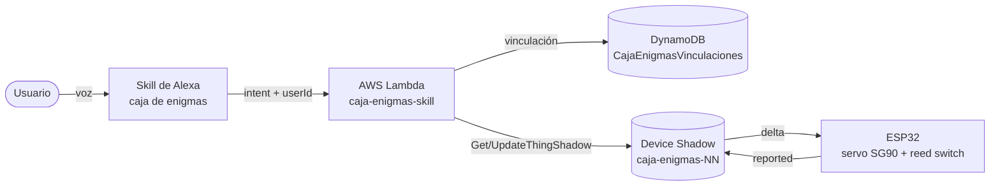

# Caja de los Enigmas — Práctica 3 SIS-234

Objeto inteligente con ESP32 integrado con **Alexa** mediante **AWS IoT Core** (Device Shadow), **AWS Lambda** (Python) y **DynamoDB**. Es el primer módulo del proyecto final *Escape Room IoT: La Caja de los Enigmas*. El prototipo entregado es un montaje de mesa: un SG90 representa la cerradura y un reed con imán representa la apertura de la tapa, sin pestillo acoplado.

**Integrantes:** Santiago Torres · Adrián Mercado · Mateo Rojas · Lucía Escobar



## Estructura

```text
firmware/        Objeto inteligente (PlatformIO, C++ / Arduino)
lambda/          Backend de la skill (Python 3.12)
config/alexa/    Modelo de interacción exportado
config/aws/      Política de IoT, rol IAM de la Lambda y definición de la tabla
docs/            Contratos, planificación, consigna, diagramas y evidencias
INFORME.md       Informe técnico
```

- [Informe técnico final](INFORME.md): implementación, pruebas y evidencias.
- [Índice de documentación](docs/README.md).
- [Backend de Alexa](lambda/README.md).
- [Contratos entre componentes](docs/contratos.md): Shadow, temas MQTT, vinculación, tabla, intents y pines.
- [Planificación por integrante](docs/planificacion/00-resumen.md).
- [Consigna](docs/consigna/Práctica_3.md).

## Firmware

Requisitos: PlatformIO (extensión de VS Code o `pio` en la terminal).

1. Crear las configuraciones locales, que Git ignora:

   ```powershell
   Copy-Item firmware/include/ConfiguracionWifi.ejemplo.h firmware/include/ConfiguracionWifi.h
   Copy-Item firmware/include/ConfiguracionAws.ejemplo.h firmware/include/ConfiguracionAws.h
   ```

2. Completar el SSID y la contraseña del WiFi (2.4 GHz), el endpoint de AWS IoT, el nombre del Thing y los tres certificados. Las instrucciones están en cada archivo.
3. Compilar, cargar y abrir el monitor desde `firmware/`:

   ```powershell
   cd firmware
   pio run
   pio run -t upload --upload-port COMx
   pio device monitor
   ```

Sin las copias locales, el proyecto compila con las plantillas vacías y no intenta conectarse.

Pruebas en la PC de la lógica del Shadow (`EstadoShadow`), sin placa. Requieren `g++` en el PATH (por ejemplo, MinGW):

```powershell
cd firmware
pio test -e pruebas
```

## Seguridad

- Los certificados, la clave privada del Thing y la contraseña del WiFi **no se versionan**: viven en `firmware/include/Configuracion*.h` o en `certificados-privados/`, ambos excluidos por `.gitignore`.
- No se usan access keys de AWS en ningún componente. La Lambda obtiene sus permisos de su rol IAM y el ESP32 se autentica con su certificado X.509.
- Antes de cada push, revisar `git status` para comprobar que no aparezca ningún secreto.
