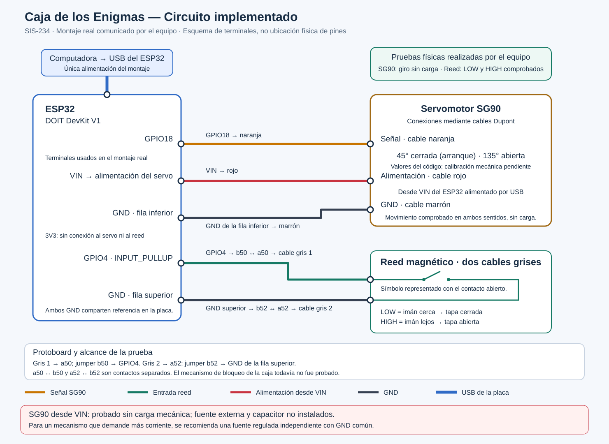

# Guía de montaje de la Caja de los Enigmas

**Estado: preparación, sin pruebas físicas realizadas.** El servo no fue probado;
el reed todavía no se compró. La fuente definitiva y el capacitor están pendientes
de compra o verificación. Los ángulos y la disposición en protoboard no están definidos.

Seguir [contratos.md](contratos.md) y el [plan de hardware](planificacion/01-santiago-hardware.md).
Esta guía desarrolla la opción de **fuente externa regulada de 5 V** prevista en el
contrato; no usa VIN para alimentar el servo ni cambia los pines acordados.
Registrar resultados reales en [PRUEBAS_FISICAS.md](PRUEBAS_FISICAS.md).

## 1. Materiales e identificación

| Elemento | Qué identificar antes de usarlo | Situación |
|---|---|---|
| ESP32 DOIT DevKit V1 y cable USB de datos | Etiquetas GPIO18, GPIO4 y GND de la placa real | Ubicación final pendiente |
| Servo SG90 y brazo de montaje | Señal, positivo y negativo según su documentación | Sin prueba física |
| Reed de dos terminales e imán | Contacto seco; no confundir con un módulo de tres pines | Pendiente de compra |
| Fuente externa regulada de 5 V CC | Salida, polaridad y capacidad de corriente apropiada para el servo concreto | Pendiente de selección/verificación |
| Conector o adaptador de baja tensión para la fuente | Terminales + y − identificados y aislados | Por definir |
| Protoboard y cables | Continuidad de grupos y posibles cortes de rieles según el modelo | Distribución pendiente |
| Capacitor electrolítico de 470–1000 µF, opcional | Polaridad y tensión nominal superior a 5 V | Pendiente de compra/verificación |
| Caja, pestillo, fijaciones y soporte del sensor | Recorrido libre y cierre que se sostenga sin esfuerzo continuo del servo | Geometría pendiente |
| Computadora con PlatformIO | Diagnósticos ya disponibles en `firmware/pruebas/` | Ejecución física pendiente |
| Regla y cámara o teléfono | Medir distancia del imán y registrar evidencias | Comprobar disponibilidad |
| Multímetro u otro instrumento adecuado | Necesario si se requiere confirmar tensión, polaridad o continuidad no documentadas | No se presupone disponible |

### Qué puede comprobarse sin instrumentos

Una inspección visual permite leer etiquetas, comparar terminales con la ficha del
componente, seguir cables y detectar daños, conexiones flojas o puentes evidentes.
**No demuestra** que la fuente entregue realmente 5 V ni que un cable o riel tenga
continuidad interna. Los colores tampoco demuestran polaridad.

La medición de tensión/polaridad requiere un instrumento adecuado y una persona
que sepa usarlo; la continuidad se mide únicamente con el circuito sin energía.
Si la fuente o su adaptador carecen de identificación inequívoca, son modificados,
están dañados o generan dudas, **no conectar el circuito** hasta verificarlos con
instrumentos y ayuda competente. No reemplazar una medición crítica por una suposición.
Con una fuente identificada y documentada, registrar por separado sus datos
declarados y las mediciones, si las hay; nunca escribir «5 V medidos» sin medir.

No abrir cargadores ni manipular su lado de 220 V CA. Usar un adaptador de salida
de baja tensión apropiado; no cortar cables para preparar la alimentación.

## 2. Leer el esquema antes de conectar



El dibujo identifica terminales eléctricos; **no es un mapa de la placa ni de la
protoboard**. Localizar los pines por las etiquetas y documentación de la placa
real. No copiar su posición gráfica al montaje. Los agujeros concretos se definirán
con una fotografía del montaje disponible.

| Red | Conexiones previstas |
|---|---|
| USB | Alimentación propia del ESP32, mediante su conector USB |
| Señal SG90 | GPIO18 → señal del SG90, habitualmente naranja |
| +5 V externo | Positivo de fuente → positivo del SG90, habitualmente rojo; capacitor + si se instala |
| GND común | Negativo de fuente, GND del SG90, GND del ESP32, un terminal del reed y capacitor − si se instala |
| Entrada reed | GPIO4 → otro terminal del reed; `SensorTapa` activa `INPUT_PULLUP` |

Los colores del servo son habituales, no una garantía: confirmar el cableado del
ejemplar. El reed simple de dos terminales no lleva + y − de alimentación; lo
pendiente es su respuesta al imán y la **polaridad lógica** que representa tapa
cerrada. LOW = cerrada / HIGH = abierta sigue siendo una convención provisional.

## 3. Preparar la mesa, la placa y los diagnósticos

1. Separar servo, ESP32, fuente y sensor. Dejar USB y fuente externa desconectados.
   **Comprobar:** ningún circuito recibe energía. **Continuar:** solo sin tensión.
2. Revisar placa, cables y protoboard por daños. Identificar grupos de contactos,
   rieles partidos y espacio para la placa sin doblar pines ni unir filas opuestas.
   **Comprobar:** distribución conocida por documentación o continuidad sin energía.
   **Continuar:** solo si puede explicarse dónde conecta cada extremo; no inventar agujeros.
3. Identificar los tres cables del SG90 y los bornes de la fuente/adaptador.
   **Comprobar:** coinciden etiquetas, ficha y orientación del conector.
   **Continuar:** solo si positivo, negativo y señal están identificados sin dudas.
4. Verificar que la fuente declarada es regulada de 5 V CC y que su capacidad de
   corriente cubre lo indicado para el servo concreto. Si hay que medir la fuente,
   hacerlo todavía separada de ESP32 y servo, con instrumento adecuado y ayuda;
   desconectarla después. **Continuar:** solo con la revisión de la prueba 1 registrada
   y sin incertidumbres críticas. No inferir capacidad por el tamaño del cargador.
5. Con **todos los periféricos desconectados**, conectar únicamente el USB al ESP32
   para cargar el diagnóstico que se usará. Seguir el
   [README de diagnósticos](../firmware/pruebas/README.md). Comprobar placa y puerto
   correctos antes de cargar. Desconectar el USB al terminar, antes de cablear.
   **Continuar:** solo con el diagnóstico elegido identificado y ambas fuentes apagadas.

Los comandos siguientes son instrucciones para **más adelante**; no se han ejecutado
como parte de esta documentación. Desde la raíz del repositorio:

```powershell
pio run -d firmware/pruebas -e servo -t upload
pio device monitor -d firmware/pruebas -e servo
```

Para el reed se sustituye `servo` por `reed`. El monitor usa 115200 baudios.
Cada carga reemplaza el programa anterior. Los diagnósticos no usan AWS.

## 4. Conectar el servo, un cable por vez

**USB y fuente externa desconectados durante todos estos pasos.** Mantener el
servo sin carga y sin brazo conectado a la cerradura. Después de cada fila revisar
la conexión antes de pasar a la siguiente; si no coincide, corregir sin energía.

| Paso | Una conexión | Comprobación antes de continuar | Criterio para continuar |
|---|---|---|---|
| S1 | Negativo de fuente → GND del ESP32 | Seguir el cable desde el borne − identificado hasta un pin rotulado GND | Referencia común, sin pasar por 3V3 ni VIN/5V |
| S2 | GND del servo → negativo de fuente/GND común | Revisar terminal real del servo y unión firme a la red GND | Negativo del servo inequívoco y común al ESP32 |
| S3 | Positivo de fuente → positivo del servo | Seguir el cable desde + hasta el positivo confirmado del SG90 | No llega a GPIO, 3V3, VIN/5V ni positivo USB |
| S4, opcional | Capacitor + → +5 V del servo | Leer identificación del terminal + y tensión nominal; no fiarse solo del largo de las patas | 470–1000 µF, tensión nominal superior a 5 V y polaridad identificada |
| S5, opcional | Capacitor − → GND del servo | Confirmar el terminal negativo mediante la marca del componente y que no haya puente entre patas | Capacitor en paralelo entre +5 V y GND, sin inversión ni cortocircuito |
| S6 | Señal del servo → GPIO18 | Seguir el cable de señal confirmado hasta el pin etiquetado GPIO18 | Señal separada de +5 V; GPIO18 no alimenta el motor |

Si no se instala capacitor, omitir **ambos** pasos opcionales y registrarlo.
Colocarlo cerca de la alimentación del servo cuando se instale. No sustituye una
fuente adecuada. Antes de manipularlo tras una prueba, desconectar fuentes y
comprobar que no retenga tensión peligrosa para el circuito; no descargarlo con un
cortocircuito. Si hay duda sobre carga residual, pedir ayuda antes de tocar bornes.

## 5. Revisión completa y primera prueba del SG90

Antes de energizar, otra persona del grupo puede ayudar a seguir cada cable del
esquema. Confirmar **todos** estos puntos:

- Fuente/adaptador identificados y revisados; cableado sin puentes, daños ni extremos expuestos.
- S1–S3 y S6 correctos; S4–S5 correctos o capacitor ausente.
- Positivos de USB y fuente externa **sin unión**. No hay +5 V externo en 3V3 ni VIN/5V.
- GND común presente. Servo sin carga, brazo desacoplado y eje libre, sin forzarlo a mano.
- Diagnóstico `servo` cargado; no firmware desconocido que pueda moverlo al arrancar.
- Forma de desconectar ambas alimentaciones accesible; no mover cables energizados.

Solo después de superar la revisión, alimentar el ESP32 por USB y el servo por su
fuente externa. No enviar órdenes mientras falte alguna alimentación; evitar que
una señal activa alimente indirectamente un servo apagado. Si se pierde una de
ellas, detener la prueba y desconectar ambas antes de corregir.

1. Abrir el monitor. Al arrancar el diagnóstico no activa PWM ni hace barridos.
2. Escribir `estado` o `ayuda`. Revisar otra vez que el eje esté libre.
3. Escribir `iniciar`: se solicita **90° de referencia**, no «abierta» ni «cerrada».
   La posición previa es desconocida y este primer movimiento puede ser amplio.
4. Usar primero `+` y `-`: cambian 1°. También se aceptan enteros dentro de 45°–135°,
   con diferencia máxima de 5° respecto de la orden anterior y al menos 300 ms
   entre movimientos. Observar y esperar la finalización real de cada movimiento.
5. Registrar ángulos solicitados y observaciones en la prueba 2. El número impreso
   no es una medición de la posición del eje. No buscar topes ni asumir que todo
   servo rotulado SG90 tiene el mismo recorrido.
6. Ante atasco, esfuerzo, calentamiento anormal o reinicios, interrumpir ambas
   alimentaciones y revisar sin energía. No insistir con órdenes repetidas.

No hay `detach()` automático: el PWM permanece activo. No desconectarlo
inmediatamente después de una orden; observar que termine el movimiento antes
de un apagado normal. La ventana 45°–135° solo limita la exploración inicial.

## 6. Conectar y probar el reed por separado

1. Desconectar ambas alimentaciones. Retirar del ESP32 las conexiones del servo
   para la prueba aislada del reed; aislar los extremos y dejar su fuente apagada.
   **Comprobar:** sin señal ni alimentación accidental al servo.
   **Continuar:** solo con el servo separado y sin energía.
2. Con periféricos separados, cargar `reed` por USB según el README; desconectar
   después el USB para realizar las dos conexiones siguientes.

| Paso | Una conexión, sin energía | Comprobación antes de continuar | Criterio para continuar |
|---|---|---|---|
| R1 | Un terminal del reed → GND del ESP32 | Seguir el cable al pin GND; revisar vidrio/encapsulado sin forzar las patas | Contacto seco de dos terminales identificado, sin daño |
| R2 | Otro terminal del reed → GPIO4 | Seguir el cable al pin GPIO4; comprobar que no toca +5 V ni otros pines | Reed entre GPIO4 y GND, sin alimentación externa del sensor |

3. Revisar R1 y R2 y el aislamiento del servo antes de conectar **solo el USB**.
4. Abrir el monitor; el programa activa `INPUT_PULLUP` y muestra la lectura inicial
   sin evento de cambio. Acercar y alejar lentamente el imán.
5. Comparar las líneas eléctricas (`LOW`: contacto a GND; `HIGH`: contacto abierto)
   con la interpretación provisional de `SensorTapa`. Registrar el comportamiento
   real; no dar por comprobado LOW = tapa cerrada.
6. Registrar distancia y orientación del imán y observar el antirrebote según las
   pruebas 4 y 5. Las líneas Serial son muestras, no un registro de todos los
   rebotes eléctricos. Desconectar USB antes de recolocar sensor o cables.

## 7. Calibrar y montar el mecanismo

1. Completar las pruebas individuales antes de unir el servo al pestillo.
2. Con todo apagado, presentar servo, soporte y pestillo, sin fijar el brazo a una
   tapa que pueda bloquearlo. Buscar una geometría que trabe y destrabe sin forzar
   el eje ni llegar al tope del servo. No usar el motor para sostener una carga continua.
3. Establecer la referencia inicial con el brazo desacoplado. Apagar antes de ajustar
   fijaciones. No volver a ordenar 90° con el mecanismo acoplado hasta verificar
   que esa posición deja recorrido libre; si no es segura, continuar desacoplado
   y revisar la geometría con el grupo antes de usar este diagnóstico.
4. Con la revisión eléctrica repetida y recorrido libre, explorar pasos pequeños y
   anotar candidatos para abierta/cerrada en la prueba 3. Si quedan fuera de la ventana
   de diagnóstico, detenerse y revisar límites del servo y geometría; no forzar ni
   ampliar el rango sin revisión. No hay ángulos definitivos en esta guía.
5. Fijar servo y pestillo sin deformaciones. Con el movimiento terminado, apagar ambas
   alimentaciones y comprobar que el cierre se sostiene mecánicamente sin PWM ni
   fuerza continua del motor; no aplicar fuerza a un engranaje trabado.
6. Fijar reed e imán en posiciones que distingan tapa abierta y cerrada, dentro de la
   distancia verificada, protegiendo el reed de golpes y tensión de los cables.
7. Registrar fotografía y ubicación real en protoboard; recién entonces asignar
   posiciones concretas. Sujetar cables lejos del brazo y dejar acceso al USB.
8. Compartir ángulos y polaridad medidos con Adrián para revisar el contrato y la
   integración. `CerraduraServo.iniciar()` ordena cerrar: ese arranque también debe
   tener un recorrido seguro. No modificar ni cargar integración todavía sin revisión.

## 8. Revisión final y pendientes

Repetir S1–S6 y R1–R2 sin energía al reunir el montaje completo. Fotografiarlo y
compararlo con el esquema. Revisar fijaciones, recorrido, aislamiento, GND común,
polaridad del capacitor y separación de positivos antes de energizar.

| Decisión o comprobación | Estado |
|---|---|
| Modelo y fuente definitiva, corriente disponible, polaridad de salida | Pendiente |
| Capacitor: instalación, valor, tensión nominal y polaridad | Pendiente |
| Foto y distribución real en protoboard | Pendiente |
| Recorrido del SG90 y ángulos abierta/cerrada seguros | Pendiente |
| Cierre sostenido sin servo energizado | Pendiente |
| Reed comprado, respuesta al imán, distancia y orientación | Pendiente |
| Confirmación o corrección de LOW = tapa cerrada | Pendiente |
| Pruebas con firmware integrado, AWS y Alexa | Pendiente, en coordinación con el grupo |

Las clases locales y diagnósticos no equivalen a integración completa. El
`main.cpp` revisado mantiene WiFi y todavía no integra servo, sensor y Shadow.
Las pruebas integradas no pueden aprobarse con los diagnósticos individuales.

## Referencias técnicas

- [Contrato del proyecto](contratos.md): pines, alimentación, estados y responsabilidades.
- [GPIO de Arduino-ESP32, Espressif](https://docs.espressif.com/projects/arduino-esp32/en/latest/api/gpio.html): `INPUT_PULLUP` y lectura HIGH/LOW.
- [SG90 Digital, TowerPro](https://towerpro.com.tw/product/sg90-7/): referencia del fabricante; no sustituye la ficha del ejemplar adquirido ni confirma sus límites físicos.
