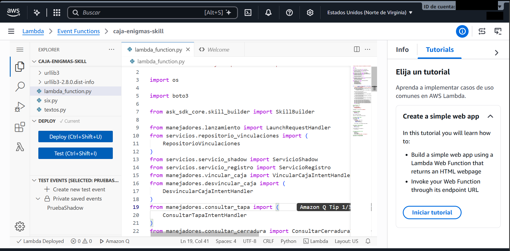
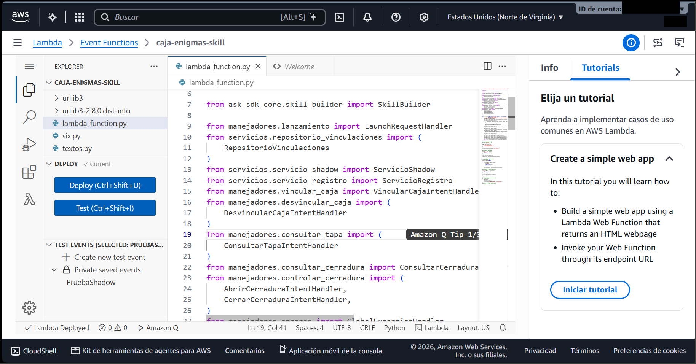
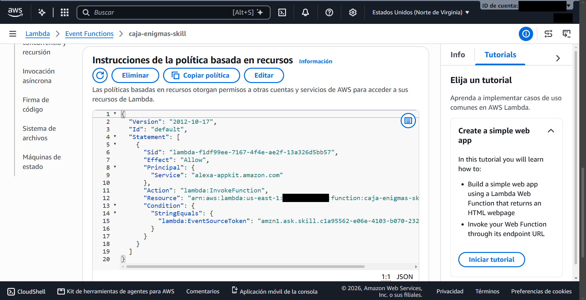
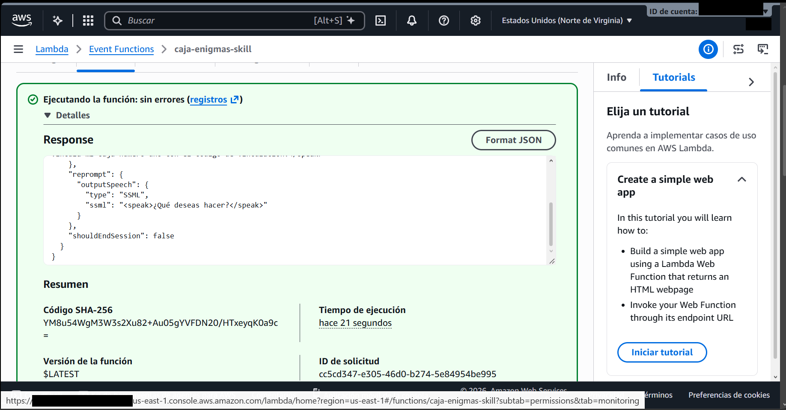
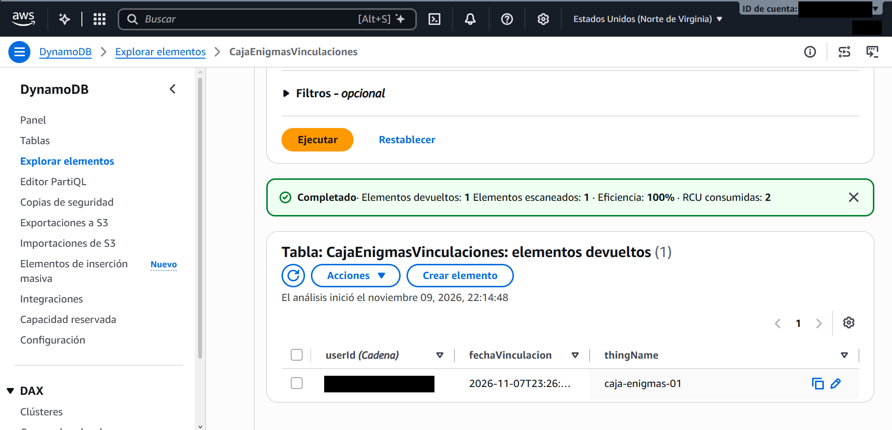
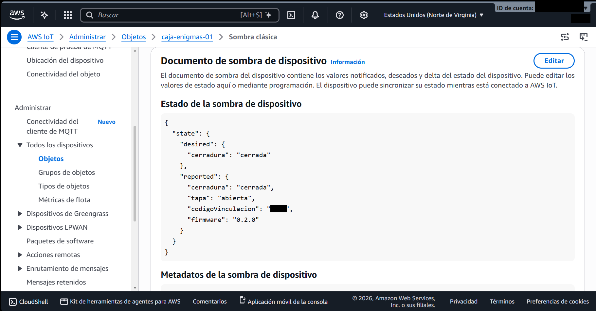
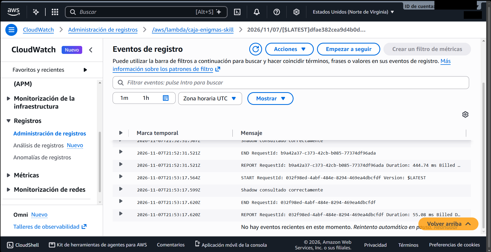

# Aporte de Mateo para integrar en INFORME.md

Este archivo prepara las secciones de responsabilidad de Mateo. No modifica
el informe común. Lucía puede incorporar los bloques numerados en sus lugares
correspondientes, conservando los textos y diagramas de sus compañeros.
Los caminos de código se expresan desde la raíz del repositorio para que el
texto siga siendo válido al copiarlo a `INFORME.md`.

Las secciones compartidas 2.5 y 4.2 son aportes para combinar con Lucía. La
arquitectura completa del backend y las secuencias adicionales se encuentran
en [INFORME_TECNICO.md](INFORME_TECNICO.md); la
[auditoría](AUDITORIA_FINAL.md) contiene la lista de evidencias y pendientes.
No completar resultados experimentales antes de disponer de sus registros.

### 2.4 Diagrama de clases de la función Lambda

La función `crear_skill`, en `lambda/lambda_function.py`, compone los
manejadores con servicios inyectados y los registra en `SkillBuilder`.
Cada manejador implementa selección (`can_handle`) y atención (`handle`).
Los servicios separan persistencia, registro de Things y acceso al Shadow.


`manejadores/identidad.py` contiene la función común `obtener_user_id`, que
extrae únicamente la identidad de `context.System.user` y rechaza su ausencia.
Los clientes boto3 se reutilizan entre invocaciones y se reemplazan por mocks
en las pruebas. La vinculación de usuarios no se almacena en variables
globales de la función.

### 2.5 Aporte al diagrama de secuencia de vinculación

Este diagrama representa el diseño implementado, no una captura experimental.
Debe acompañarse con las secuencias de consulta de tapa y comando del informe
técnico, coordinadas con Lucía.

```mermaid
sequenceDiagram
    actor U as Usuario
    participant A as Alexa
    participant L as Lambda
    participant I as Registro IoT
    participant S as Shadow clásico
    participant D as DynamoDB
    U->>A: Vincula mi caja con su número y código
    A->>L: VincularCajaIntent, slots y context.System.user.userId
    L->>L: Validar identidad, número y código de cuatro dígitos
    L->>I: DescribeThing(caja-enigmas-NN)
    alt Thing inexistente
        I-->>L: ResourceNotFoundException
        L-->>A: Informar que no existe; no guardar
    else Thing existente
        I-->>L: Thing válido
        L->>S: GetThingShadow(thingName)
        S-->>L: reported.codigoVinculacion
        alt Código string coincidente
            L->>D: PutItem(userId, thingName, fechaVinculacion)
            D-->>L: Vinculación guardada o reemplazada
            L-->>A: Confirmar vinculación
        else Código incorrecto o fuera del contrato
            L-->>A: Informar código incorrecto; no guardar
        end
    end
    A-->>U: Respuesta en español
```

### 2.7 Diseño del mecanismo de vinculación

La identidad persistente es `context.System.user.userId`. El número de caja
forma el nombre `caja-enigmas-NN`, con dos dígitos; el código ingresado es una
cadena de cuatro dígitos ASCII que conserva sus ceros iniciales. La Lambda
verifica la existencia del Thing y compara el código con
`reported.codigoVinculacion`, también de tipo string, antes de guardar.

La tabla `CajaEnigmasVinculaciones` tiene clave de partición `userId` String,
sin clave de ordenación, y capacidad on-demand. Cada ítem guarda `thingName`
String y `fechaVinculacion` String en ISO-8601 UTC, representada por el código
con desplazamiento `+00:00`. `PutItem` con la misma clave reemplaza la caja
del usuario; `DeleteItem` elimina la vinculación sin borrar el Thing ni
afectar a otros usuarios. Cada consulta/comando resuelve de nuevo la relación
con `GetItem` y lectura consistente.

### 3.2 Estructura del código de la función Lambda

`lambda/lambda_function.py` registra los manejadores y expone
`lambda_function.lambda_handler`. `lambda/manejadores/` implementa bienvenida,
vinculación, desvinculación, consulta de tapa/cerradura, apertura/cierre,
intents integrados y errores. `lambda/servicios/` implementa las operaciones
de DynamoDB y AWS IoT. Los constructores reciben sus dependencias, permitiendo
probar la lógica con clientes sustituidos.

`ServicioShadow.leer_estado` obtiene desired/reported en una única lectura;
`leer_reported` conserva la interfaz de consultas y vinculación.
`pedir_cerradura` solo admite `abierta` o `cerrada` y escribe únicamente
`state.desired.cerradura`. Si desired difiere de reported, la consulta informa
la orden pendiente. Un comando aceptado por AWS se anuncia como enviado; no
se afirma que el servo se movió. El firmware debe aplicar el delta y reportar
la confirmación, conforme al contrato del grupo.

La auditoría final añadió validación defensiva de identidad, validación local
del formato del código antes de consultar AWS, rechazo del código reportado
numérico y escape de XML al construir SSML con datos dinámicos. El manejador
global devuelve una frase genérica y registra solo categorías/operaciones
permitidas, sin eventos completos, userId, códigos, tokens ni mensajes de
excepción. Cancelar/parar cierra la sesión sin borrar una orden ya enviada.

### 3.4 Configuración de Lambda, DynamoDB y rol IAM

Los contratos fijan `us-east-1`, función `caja-enigmas-skill`, Python 3.12,
handler `lambda_function.lambda_handler`, rol `caja-enigmas-lambda-rol` y las
variables `TABLA_VINCULACIONES`, `PREFIJO_THING` e `IOT_ENDPOINT`.
Mateo comunicó que estos recursos y el desencadenador Alexa Skills Kit están
configurados. Las siete capturas revisadas se describen en
[Evidencias de implementación en AWS](#evidencias-de-implementación-en-aws).
La captura 04 identifica una ejecución de `$LATEST` cuyo hash coincide con
el ZIP definitivo local. No se inspeccionó la cuenta directamente: las
capturas no muestran el runtime, la arquitectura, las variables de entorno,
el conjunto de políticas del rol ni el endpoint efectivo de Alexa.

| Permiso exportado | Recurso y justificación |
|---|---|
| `iot:DescribeThing` | Things `caja-enigmas-*` de la cuenta del grupo en `us-east-1`; validar existencia. |
| `iot:GetThingShadow` | Los mismos Things; leer código, sensor y estado del actuador. |
| `iot:UpdateThingShadow` | Los mismos Things; solicitar apertura o cierre. |
| `dynamodb:GetItem` | Tabla `CajaEnigmasVinculaciones`; resolver la caja por usuario. |
| `dynamodb:PutItem` | La misma tabla; crear o cambiar la vinculación. |
| `dynamodb:DeleteItem` | La misma tabla; desvincular al usuario. |

Estos permisos constan en `config/aws/politica-rol-lambda.json`; la definición
de tabla está en `config/aws/tabla-vinculaciones.json`. El plan prevé además
`AWSLambdaBasicExecutionRole` para CloudWatch Logs; esa política y la
confianza del rol deben acreditarse con la configuración activa. Los JSON
locales no demuestran por sí solos los permisos efectivos ni permiten
afirmar que no haya otras políticas aplicadas. El rol no necesita acceso
general a DynamoDB ni publicar MQTT desde Lambda. En producción se deben
acotar también los permisos de logs y revisar todas las políticas activas.

La verificación del Skill ID en el disparador ASK controla qué skill puede
invocar la Lambda; es distinta del rol con que Lambda accede a IoT/DynamoDB.
No se almacenan access keys en el backend: AWS proporciona autorización por
el rol de ejecución. Los ZIP y paquetes generados están excluidos de Git.

### Evidencias de implementación en AWS

La serie consta de **siete capturas**, numeradas consecutivamente del **01 al
07**. Las figuras enlazan las copias preparadas para compartir en
`docs/evidencias/mateo-lambda/para-informe/`. Se ocultaron con rectángulos
sólidos el código de vinculación, el identificador de usuario de Alexa, el
usuario de la consola y el número de cuenta AWS donde aparecía, incluidos
el ARN y la URL. Se conservaron las dimensiones y todos los píxeles fuera
de esas zonas. Los originales permanecen intactos, como archivos locales
excluidos de Git; se publican únicamente las copias.

Las rutas de las figuras son relativas a `lambda/APORTE_INFORME.md`. Al
integrar esta sección en `INFORME.md` de la raíz, cambiar el prefijo
`../docs/` por `docs/`. Las capturas documentan lo visible al tomarlas;
no equivalen a una revisión actual de la cuenta mediante AWS.

#### Evidencia 01. Código principal de la función Lambda



La consola muestra la función `caja-enigmas-skill` en Norte de Virginia, el
archivo `lambda_function.py`, sus importaciones de boto3, `SkillBuilder` y
servicios, y archivos del paquete como `textos.py`, `six.py` y `urllib3`.
El editor indica `Lambda Deployed`. Documenta la presencia del código y de
dependencias en la función, pero no muestra la configuración del handler ni
del runtime.

#### Evidencia 02. Importación de los manejadores y servicios



Otra vista del mismo `lambda_function.py` permite leer las importaciones del
repositorio, registro IoT, servicio Shadow y manejadores de vinculación,
desvinculación, consultas y apertura/cierre. Complementa la figura 01 y
evidencia la organización modular; no es una captura de variables de entorno
ni una prueba individual de cada intent.

#### Evidencia 03. Permiso de invocación para Alexa Skills Kit



La política basada en recursos de la función muestra `Effect: Allow`, el
principal `alexa-appkit.amazon.com`, la acción `lambda:InvokeFunction` y una
condición `StringEquals` sobre `lambda:EventSourceToken` con un identificador
de skill. Documenta la restricción de invocación a una skill. No corresponde
a la política del rol de ejecución y no acredita sus permisos sobre IoT,
DynamoDB o CloudWatch. El valor completo del Skill ID no puede contrastarse
con el endpoint de Alexa a partir de esta vista.

#### Evidencia 04. Ejecución de `$LATEST` con el paquete definitivo



La consola informa ejecución sin errores y muestra una respuesta JSON de
Alexa con `reprompt` SSML y `shouldEndSession: false`. El resumen identifica
`$LATEST` y el código SHA-256 en base64
`YM8u54WgM3W3s2Xu82+Au05gYVFDN20/HTxeyqK0a9c=`. Este coincide con el hash
calculado sobre `lambda/caja-enigmas-skill.zip`, cuyo SHA-256 hexadecimal es
`60cf2ee785a03375b7b365eef36f80bb4e60615143376d3f1d3c5ecaa2b46bd7`.
La coincidencia vincula el paquete preparado con la ejecución de consola
capturada: AWS define ese campo como el hash del
[paquete de despliegue](https://docs.aws.amazon.com/lambda/latest/api/API_GetFunctionConfiguration.html#lambda-GetFunctionConfiguration-response-CodeSha256).

El evento de entrada y la respuesta de voz principal no son legibles en
esta vista; no se atribuye la ejecución a un intent concreto ni se presenta
como prueba de voz con Alexa. La indicación «hace 21 segundos» expresa cuánto
tiempo pasó desde la ejecución, no su duración.

#### Evidencia 05. Vinculación almacenada en DynamoDB



El explorador de `CajaEnigmasVinculaciones` devuelve un ítem con las columnas
`userId (Cadena)`, `fechaVinculacion` y `thingName`; esta última contiene
`caja-enigmas-01`. La consulta de consola muestra un elemento devuelto y uno
escaneado. Demuestra la persistencia de una relación usuario-caja en ese
resultado. El identificador de usuario está oculto por privacidad y la fecha
aparece truncada en la captura: no se infieren sus valores completos, la
clave de ordenación ni el modo de capacidad de la tabla. Tampoco identifica
qué ejecución creó el ítem.

#### Evidencia 06. Estado del Shadow clásico de la caja 01



La vista de sombra clásica de `caja-enigmas-01` muestra
`desired.cerradura: cerrada` y `reported.cerradura: cerrada`; también muestra
`reported.tapa: abierta`, `reported.firmware: 0.2.0` y el campo
`codigoVinculacion`. Documenta los atributos contractuales y la coincidencia
de estados en esa instantánea. No se exponen aquí ni se transcriben los
dígitos del código de vinculación.

La coincidencia no identifica quién escribió `reported` ni demuestra
movimiento físico del servo. La parte visible tampoco aporta la versión ni
los timestamps del Shadow que permitirían correlacionarlo con una orden.

#### Evidencia 07. Registros de ejecución en CloudWatch



Se observa el grupo `/aws/lambda/caja-enigmas-skill`, un flujo de `$LATEST`
y eventos del **07/11/2026 en UTC**, anteriores a la preparación del ZIP
definitivo del 09/11. En el fragmento visible aparecen `START`, `END`,
`REPORT` y el mensaje `Shadow consultado correctamente`. Dos filas `REPORT`
muestran duraciones de **444,74 ms** y **55,08 ms**.

Documenta que hubo ejecuciones y registros en CloudWatch en esa fecha; no
acredita las políticas completas del rol ni las ejecuciones del paquete
definitivo. Son dos muestras de duración Lambda, no una medición de latencia
de voz de extremo a extremo, un promedio representativo ni evidencia de que
todos los eventos del grupo carezcan de errores.

### 4.2 Aporte a pruebas funcionales y de la skill

| Tipo de verificación | Resultado y alcance |
|---|---|
| Unitarias y flujos con mocks | 76 pruebas aprobadas con Python 3.12.10: 67 anteriores conservadas y 9 regresiones de auditoría. Cubren RF4–RF9, dos usuarios, códigos incorrectos, Thing inexistente, estados pendientes y errores de AWS/red. |
| Sintaxis | `compileall` aprobado para el código y las pruebas del backend en Python 3.12.10. |
| Ejecución real en consola Lambda | Captura 04: ejecución de `$LATEST`, hash coincidente con el ZIP definitivo y fragmento de respuesta Alexa. El evento y el intent exactos no quedan acreditados. |
| Persistencia real en DynamoDB | Captura 05: una relación almacenada con `thingName=caja-enigmas-01`. No identifica la ejecución que la creó. |
| Estado real consultado en IoT Core | Captura 06: ambos estados de cerradura son `cerrada`; tapa reportada `abierta`. Origen del reporte, timestamps y aplicación física sin acreditar. |
| Registros reales en CloudWatch | Captura 07: eventos del 07/11 con dos duraciones visibles. Es evidencia anterior al ZIP definitivo. |
| Alexa real comunicada por Mateo | Antecedente: vinculación de caja 1, consulta de estado y envío de cierre. Estas capturas no muestran la conversación ni precisan el intent consultado; falta la regresión completa con Lucía sobre el endpoint efectivo. |
| ESP32 y servomotor físicos | Pendiente. No se afirma movimiento físico ni confirmación originada por el firmware. |
| RNF | Dos muestras históricas de duración Lambda en la captura 07. Latencia de voz de extremo a extremo, estabilidad, exactitud, frecuencia de reporte y reconexión siguen pendientes de medición. |

Las pruebas se encuentran en `lambda/tests/`; `test_flujos_skill.py` conserva
los servicios reales y simula boto3, mientras otros tests sustituyen los
servicios. El dispatcher y la serialización del SDK de Alexa se ejercitan
localmente. `test_auditoria.py` cubre las regresiones nuevas. Ningún test
unitario es evidencia de reconocimiento de voz, escritura en AWS real o
movimiento del actuador.

### 4.8 Aporte a incidencias y límites de resultados

La auditoría reprodujo fallos de identidad incompleta, aceptación de código
reportado numérico, consultas innecesarias ante un código inválido y SSML
dinámico sin escape; se corrigieron y se preservó la suite anterior.
El SDK de Alexa emite `SyntaxWarning` de escapes con Python 3.12, sin impedir
la suite. No se alteró código de las bibliotecas de terceros.

El ZIP definitivo ya fue reconstruido y verificado localmente, según
[DESPLIEGUE_FINAL.md](DESPLIEGUE_FINAL.md). La captura 04 registra una ejecución
de `$LATEST` con el mismo hash. Esto no establece qué versión o alias invoca
Alexa ni acredita toda la configuración desplegada. La captura 07 y las
pruebas reales comunicadas anteriormente son antecedentes del backend previo.

Queda pendiente repetir con Lucía la regresión completa de RF4–RF9 en el
endpoint efectivo: intents, slots por voz, dos usuarios, código incorrecto,
Thing inexistente, cambio de caja, desvinculación y caja desconectada.
Con Adrián/Santiago falta comprobar el sensor, movimiento real del servo,
autoría y tiempos de `reported`, aplicación del delta, reconexión y orden
pendiente. La igualdad de desired/reported no demuestra por sí sola movimiento
ni autoría del reporte. Las mediciones del plan siguen pendientes, salvo las
dos muestras históricas de duración Lambda descritas en la evidencia 07.
