# Aporte de Mateo para integrar en INFORME.md

Este archivo prepara las secciones de responsabilidad de Mateo. No modifica
el informe común. Lucía puede incorporar los bloques numerados en sus lugares
correspondientes, conservando los textos y diagramas de sus compañeros.
Los caminos de código se expresan desde la raíz del repositorio para que el
texto siga siendo válido al copiarlo a `INFORME.md`.

Las secciones compartidas 2.5 y 4.2 son aportes para combinar con Lucía. La
arquitectura completa del backend y las secuencias adicionales se encuentran
en [INFORME_TECNICO.md](INFORME_TECNICO.md); la
[auditoría](AUDITORIA_FINAL.md) contiene la lista de evidencias y pendientes.
No completar resultados experimentales antes de disponer de sus registros.

### 2.4 Diagrama de clases de la función Lambda

La función `crear_skill`, en `lambda/lambda_function.py`, compone los
manejadores con servicios inyectados y los registra en `SkillBuilder`.
Cada manejador implementa selección (`can_handle`) y atención (`handle`).
Los servicios separan persistencia, registro de Things y acceso al Shadow.

```mermaid
classDiagram
    class SkillBuilder
    class AbstractRequestHandler
    class AbstractExceptionHandler
    class LaunchRequestHandler
    class VincularCajaIntentHandler
    class DesvincularCajaIntentHandler
    class ConsultarTapaIntentHandler
    class ConsultarCerraduraIntentHandler
    class CambiarCerraduraIntentHandler
    class AbrirCerraduraIntentHandler
    class CerrarCerraduraIntentHandler
    class HelpIntentHandler
    class CancelOrStopIntentHandler
    class FallbackIntentHandler
    class NavigateHomeIntentHandler
    class SessionEndedRequestHandler
    class GlobalExceptionHandler
    class RepositorioVinculaciones {
        +obtener(user_id)
        +guardar(user_id, thing_name)
        +eliminar(user_id)
    }
    class ServicioRegistro {
        +existe_thing(thing_name)
    }
    class ServicioShadow {
        +leer_estado(thing_name)
        +leer_reported(thing_name)
        +pedir_cerradura(thing_name, estado)
    }
    AbstractRequestHandler <|-- LaunchRequestHandler
    AbstractRequestHandler <|-- VincularCajaIntentHandler
    AbstractRequestHandler <|-- DesvincularCajaIntentHandler
    AbstractRequestHandler <|-- ConsultarTapaIntentHandler
    AbstractRequestHandler <|-- ConsultarCerraduraIntentHandler
    AbstractRequestHandler <|-- CambiarCerraduraIntentHandler
    CambiarCerraduraIntentHandler <|-- AbrirCerraduraIntentHandler
    CambiarCerraduraIntentHandler <|-- CerrarCerraduraIntentHandler
    AbstractRequestHandler <|-- HelpIntentHandler
    AbstractRequestHandler <|-- CancelOrStopIntentHandler
    AbstractRequestHandler <|-- FallbackIntentHandler
    CancelOrStopIntentHandler <|-- NavigateHomeIntentHandler
    AbstractRequestHandler <|-- SessionEndedRequestHandler
    AbstractExceptionHandler <|-- GlobalExceptionHandler
    SkillBuilder o-- AbstractRequestHandler
    SkillBuilder o-- GlobalExceptionHandler
    LaunchRequestHandler --> RepositorioVinculaciones
    VincularCajaIntentHandler --> RepositorioVinculaciones
    VincularCajaIntentHandler --> ServicioRegistro
    VincularCajaIntentHandler --> ServicioShadow
    DesvincularCajaIntentHandler --> RepositorioVinculaciones
    ConsultarTapaIntentHandler --> RepositorioVinculaciones
    ConsultarTapaIntentHandler --> ServicioShadow
    ConsultarCerraduraIntentHandler --> RepositorioVinculaciones
    ConsultarCerraduraIntentHandler --> ServicioShadow
    CambiarCerraduraIntentHandler --> RepositorioVinculaciones
    CambiarCerraduraIntentHandler --> ServicioShadow
```



`manejadores/identidad.py` contiene la función común `obtener_user_id`, que
extrae únicamente la identidad de `context.System.user` y rechaza su ausencia.
Los clientes boto3 se reutilizan entre invocaciones y se reemplazan por mocks
en las pruebas. La vinculación de usuarios no se almacena en variables
globales de la función.

### 2.5 Aporte al diagrama de secuencia de vinculación

Este diagrama representa el diseño implementado, no una captura experimental.
Debe acompañarse con las secuencias de consulta de tapa y comando del informe
técnico, coordinadas con Lucía.

```mermaid
sequenceDiagram
    actor U as Usuario
    participant A as Alexa
    participant L as Lambda
    participant I as Registro IoT
    participant S as Shadow clásico
    participant D as DynamoDB
    U->>A: Vincula mi caja con su número y código
    A->>L: VincularCajaIntent, slots y context.System.user.userId
    L->>L: Validar identidad, número y código de cuatro dígitos
    L->>I: DescribeThing(caja-enigmas-NN)
    alt Thing inexistente
        I-->>L: ResourceNotFoundException
        L-->>A: Informar que no existe; no guardar
    else Thing existente
        I-->>L: Thing válido
        L->>S: GetThingShadow(thingName)
        S-->>L: reported.codigoVinculacion
        alt Código string coincidente
            L->>D: PutItem(userId, thingName, fechaVinculacion)
            D-->>L: Vinculación guardada o reemplazada
            L-->>A: Confirmar vinculación
        else Código incorrecto o fuera del contrato
            L-->>A: Informar código incorrecto; no guardar
        end
    end
    A-->>U: Respuesta en español
```

### 2.7 Diseño del mecanismo de vinculación

La identidad persistente es `context.System.user.userId`. El número de caja
forma el nombre `caja-enigmas-NN`, con dos dígitos; el código ingresado es una
cadena de cuatro dígitos ASCII que conserva sus ceros iniciales. La Lambda
verifica la existencia del Thing y compara el código con
`reported.codigoVinculacion`, también de tipo string, antes de guardar.

La tabla `CajaEnigmasVinculaciones` tiene clave de partición `userId` String,
sin clave de ordenación, y capacidad on-demand. Cada ítem guarda `thingName`
String y `fechaVinculacion` String en ISO-8601 UTC, representada por el código
con desplazamiento `+00:00`. `PutItem` con la misma clave reemplaza la caja
del usuario; `DeleteItem` elimina la vinculación sin borrar el Thing ni
afectar a otros usuarios. Cada consulta/comando resuelve de nuevo la relación
con `GetItem` y lectura consistente.

### 3.2 Estructura del código de la función Lambda

`lambda/lambda_function.py` registra los manejadores y expone
`lambda_function.lambda_handler`. `lambda/manejadores/` implementa bienvenida,
vinculación, desvinculación, consulta de tapa/cerradura, apertura/cierre,
intents integrados y errores. `lambda/servicios/` implementa las operaciones
de DynamoDB y AWS IoT. Los constructores reciben sus dependencias, permitiendo
probar la lógica con clientes sustituidos.

`ServicioShadow.leer_estado` obtiene desired/reported en una única lectura;
`leer_reported` conserva la interfaz de consultas y vinculación.
`pedir_cerradura` solo admite `abierta` o `cerrada` y escribe únicamente
`state.desired.cerradura`. Si desired difiere de reported, la consulta informa
la orden pendiente. Un comando aceptado por AWS se anuncia como enviado; no
se afirma que el servo se movió. El firmware debe aplicar el delta y reportar
la confirmación, conforme al contrato del grupo.

La auditoría final añadió validación defensiva de identidad, validación local
del formato del código antes de consultar AWS, rechazo del código reportado
numérico y escape de XML al construir SSML con datos dinámicos. El manejador
global devuelve una frase genérica y registra solo categorías/operaciones
permitidas, sin eventos completos, userId, códigos, tokens ni mensajes de
excepción. Cancelar/parar cierra la sesión sin borrar una orden ya enviada.

### 3.4 Configuración de Lambda, DynamoDB y rol IAM

Los contratos fijan `us-east-1`, función `caja-enigmas-skill`, Python 3.12,
handler `lambda_function.lambda_handler`, rol `caja-enigmas-lambda-rol` y las
variables `TABLA_VINCULACIONES`, `PREFIJO_THING` e `IOT_ENDPOINT`.
Mateo comunicó que estos recursos y el desencadenador Alexa Skills Kit están
configurados y que el backend anterior a la auditoría está desplegado.
Falta adjuntar la configuración activa y su correspondencia con el endpoint
de Alexa; esta auditoría local no inspeccionó la cuenta.

| Permiso exportado | Recurso y justificación |
|---|---|
| `iot:DescribeThing` | Things `caja-enigmas-*` de la cuenta del grupo en `us-east-1`; validar existencia. |
| `iot:GetThingShadow` | Los mismos Things; leer código, sensor y estado del actuador. |
| `iot:UpdateThingShadow` | Los mismos Things; solicitar apertura o cierre. |
| `dynamodb:GetItem` | Tabla `CajaEnigmasVinculaciones`; resolver la caja por usuario. |
| `dynamodb:PutItem` | La misma tabla; crear o cambiar la vinculación. |
| `dynamodb:DeleteItem` | La misma tabla; desvincular al usuario. |

Estos permisos constan en `config/aws/politica-rol-lambda.json`; la definición
de tabla está en `config/aws/tabla-vinculaciones.json`. El plan prevé además
`AWSLambdaBasicExecutionRole` para CloudWatch Logs; esa política y la
confianza del rol deben acreditarse con la configuración activa. Los JSON
locales no demuestran por sí solos los permisos efectivos ni permiten
afirmar que no haya otras políticas aplicadas. El rol no necesita acceso
general a DynamoDB ni publicar MQTT desde Lambda. En producción se deben
acotar también los permisos de logs y revisar todas las políticas activas.

La verificación del Skill ID en el disparador ASK controla qué skill puede
invocar la Lambda; es distinta del rol con que Lambda accede a IoT/DynamoDB.
No se almacenan access keys en el backend: AWS proporciona autorización por
el rol de ejecución. Los ZIP y paquetes generados están excluidos de Git.

### 4.2 Aporte a pruebas funcionales y de la skill

| Tipo de verificación | Resultado y alcance |
|---|---|
| Unitarias y flujos con mocks | 76 pruebas aprobadas con Python 3.12.10: 67 anteriores conservadas y 9 regresiones de auditoría. Cubren RF4–RF9, dos usuarios, códigos incorrectos, Thing inexistente, estados pendientes y errores de AWS/red. |
| Sintaxis | `compileall` aprobado para el código y las pruebas del backend en Python 3.12.10. |
| Alexa real comunicada por Mateo | Vinculación de caja 1, consulta de estado y envío de cierre. Falta identificar el intent consultado y adjuntar fecha/capturas/logs. |
| IoT real comunicado por Mateo | Coincidencia de `desired.cerradura` y `reported.cerradura`. Falta adjuntar documento/versiones/timestamps y establecer origen del reporte. |
| ESP32 y servomotor físicos | Pendiente. No se afirma movimiento físico ni confirmación originada por el firmware. |
| RNF | Latencia de Lambda/extremo a extremo, estabilidad, exactitud, reporte y reconexión aún sin mediciones aportadas. |

Las pruebas se encuentran en `lambda/tests/`; `test_flujos_skill.py` conserva
los servicios reales y simula boto3, mientras otros tests sustituyen los
servicios. El dispatcher y la serialización del SDK de Alexa se ejercitan
localmente. `test_auditoria.py` cubre las regresiones nuevas. Ningún test
unitario es evidencia de reconocimiento de voz, escritura en AWS real o
movimiento del actuador.

### 4.8 Aporte a incidencias y límites de resultados

La auditoría reprodujo fallos de identidad incompleta, aceptación de código
reportado numérico, consultas innecesarias ante un código inválido y SSML
dinámico sin escape; se corrigieron y se preservó la suite anterior.
El SDK de Alexa emite `SyntaxWarning` de escapes con Python 3.12, sin impedir
la suite. No se alteró código de las bibliotecas de terceros.

Los cambios de producción corregidos aún requieren un nuevo ZIP y una
actualización manual de AWS. Las pruebas reales comunicadas corresponden al
backend anterior a esas correcciones. Después de actualizar, se debe repetir
la regresión con Lucía y capturar evidencias. A continuación corresponde la
prueba física con Adrián/Santiago y las mediciones del plan. La igualdad de
desired/reported no demuestra por sí sola movimiento ni autoría del reporte.
