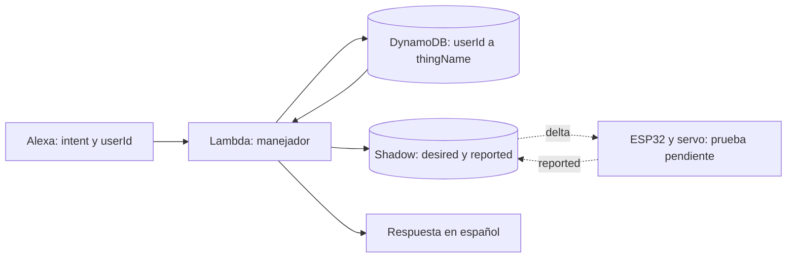

# Guía de defensa individual: backend de Mateo

Esta guía corresponde al código local auditado, con 76 pruebas en Python
3.12.10. Consultar también el [informe técnico](INFORME_TECNICO.md) y la
[auditoría con evidencias pendientes](AUDITORIA_FINAL.md).

## Explicación inicial

«Mi parte recibe las solicitudes de la skill en una Lambda Python 3.12. La
Lambda toma `context.System.user.userId`, busca en DynamoDB el nombre de la
caja del usuario y consulta o actualiza su Device Shadow clásico en IoT Core.
Las consultas leen `reported`; abrir y cerrar escriben únicamente `desired`.
El ESP32 debe recibir el delta, actuar y confirmar en `reported`. La Lambda
no envía órdenes directamente al servo ni usa una caja fija para todos».



## Recorrer tres solicitudes en el código

**Vinculación.** En [vincular_caja.py](manejadores/vincular_caja.py), señalar
`handle`: extrae identidad y slots, valida número 1–99 y código de cuatro
dígitos ASCII, forma `caja-enigmas-NN`, verifica `DescribeThing`, consulta el
Shadow y compara el código con un string reportado. Solo después persiste.
Los ceros iniciales son parte del código; convertir el código reportado a
número o aceptarlo como entero incumpliría el contrato.

**Consulta.** En [consultar_cerradura.py](manejadores/consultar_cerradura.py),
señalar `repositorio.obtener`, `shadow.leer_estado` y la comparación. Por
ejemplo, `reported.cerradura="cerrada"` y `desired.cerradura="abierta"`
significan último reporte cerrado y orden de apertura pendiente. Si falta el
reporte, la respuesta reconoce que no hay información. La tapa usa el mismo
recorrido, leyendo `reported.tapa` con `leer_reported`.

**Comando.** En [controlar_cerradura.py](manejadores/controlar_cerradura.py),
mostrar la resolución de usuario y `pedir_cerradura`. En el servicio, mostrar
el JSON con `state.desired.cerradura`. La respuesta anuncia que se envió la
orden, sin afirmar movimiento físico. No hay escritura de `reported`,
publicación MQTT desde Lambda ni espera artificial para simular confirmación.

## Clases, funciones y métodos

| Ubicación | Responsabilidad y métodos que explicar |
|---|---|
| [lambda_function.py](lambda_function.py) | `crear_skill(...)` registra manejadores en `SkillBuilder`; `sb.lambda_handler()` produce `lambda_function.lambda_handler`. Construye/reutiliza clientes AWS en `us-east-1`. |
| [identidad.py](manejadores/identidad.py) | Función `obtener_user_id`: admite contexto ausente sin acceder a AWS y usa exclusivamente `context.System.user`. No es una clase ni un almacenamiento de sesiones. |
| [RepositorioVinculaciones](servicios/repositorio_vinculaciones.py) | `obtener`: `GetItem` consistente. `guardar`: `PutItem` con fecha UTC. `eliminar`: `DeleteItem`. Recibe una tabla en el constructor. |
| [ServicioRegistro](servicios/servicio_registro.py) | `existe_thing`: `DescribeThing`; solo `ResourceNotFoundException` significa que el Thing no existe. Otros errores se propagan. |
| [ServicioShadow](servicios/servicio_shadow.py) | `leer_estado`: desired/reported de una lectura. `leer_reported`: interfaz de consultas y vinculación. `pedir_cerradura`: valida abierta/cerrada y escribe desired. `_leer_documento`: JSON y cierre del stream. |
| [LaunchRequestHandler](manejadores/lanzamiento.py) | `can_handle` identifica `LaunchRequest`; `handle` orienta según la vinculación. Escapa XML al incluir el nombre de la caja en SSML. |
| [VincularCajaIntentHandler](manejadores/vincular_caja.py) | Validaciones y persistencia solo si Thing/código son correctos. |
| [DesvincularCajaIntentHandler](manejadores/desvincular_caja.py) | Resuelve la vinculación del usuario y elimina únicamente esa relación; no borra el Thing. |
| [ConsultarTapaIntentHandler](manejadores/consultar_tapa.py) | Informa el último `reported.tapa`, sin inferir el estado desde `desired`. |
| [ConsultarCerraduraIntentHandler](manejadores/consultar_cerradura.py) | Informa lo reportado y advierte una orden pendiente. |
| [CambiarCerraduraIntentHandler](manejadores/controlar_cerradura.py) | Clase común; Abrir/Cerrar heredan y fijan intent y estado. |
| [Manejadores de sesión](manejadores/sesion.py) | Help/Fallback orientan; Cancel/Stop cierran; NavigateHome tiene cierre defensivo; SessionEnded devuelve respuesta vacía. |
| [GlobalExceptionHandler](manejadores/errores.py) | `can_handle=True`; `handle` responde sin detalles privados y registra únicamente categoría/operación permitidas. |

En los manejadores, `can_handle` decide **qué solicitud corresponde** y
`handle` implementa **qué hacer**. El builder los registra; el dispatcher del
SDK los selecciona y serializa la respuesta. Los nombres deben coincidir con
el modelo de Alexa de Lucía; no se cambian arbitrariamente.

## Inyección de dependencias y pruebas

Un constructor recibe el objeto que necesita: el repositorio recibe una tabla,
los servicios un cliente boto3 y los manejadores esos servicios. Así el
comportamiento no queda acoplado a crear clientes reales dentro de cada
petición. En las pruebas se reemplazan por `MagicMock`; también hay flujos que
conservan los servicios reales y simulan únicamente boto3.

Esto no significa reemplazar el SDK de Alexa: varias pruebas pasan por el
`SkillBuilder`, el dispatcher y la serialización reales. Los clientes de
arranque se simulan antes de importar el módulo en [apoyo.py](tests/apoyo.py),
por lo que no se necesitan access keys ni se consulta AWS durante unittest.

| Pruebas | Qué demostrar durante la defensa |
|---|---|
| [test_vincular_caja.py](tests/test_vincular_caja.py), [test_servicio_registro.py](tests/test_servicio_registro.py) | Código incorrecto, campos faltantes, Thing inexistente y permisos denegados. |
| [test_repositorio_vinculaciones.py](tests/test_repositorio_vinculaciones.py), [test_lanzamiento.py](tests/test_lanzamiento.py) | Persistencia y usuario sin caja. |
| [test_consultar_tapa.py](tests/test_consultar_tapa.py), [test_desvincular_caja.py](tests/test_desvincular_caja.py) | Tapa abierta/cerrada/desconocida y eliminación aislada. |
| [test_servicio_shadow.py](tests/test_servicio_shadow.py), [test_estado_shadow.py](tests/test_estado_shadow.py) | Payload solo desired, errores de AWS/JSON y compatibilidad de `leer_reported`. |
| [test_cerradura.py](tests/test_cerradura.py) | Reportado contra deseado, órdenes pendientes y ausencia de confirmación física. |
| [test_flujos_skill.py](tests/test_flujos_skill.py) | Dos usuarios, dos cajas, cambiar y desvincular sin afectar al otro. Las solicitudes usan un usuario de sesión diferente para comprobar que manda `context.System`. |
| [test_sesion_y_errores.py](tests/test_sesion_y_errores.py) | Despacho de intents, cierre y ausencia de datos privados en los logs propios. |
| [test_auditoria.py](tests/test_auditoria.py) | Identidad incompleta, código string, evitar consultas por datos inválidos, SSML y fallos de red. |

Comando para mostrar las **76 pruebas**, sin contar subtests por separado:

```powershell
py -3.12 -m unittest discover -s lambda/tests -v
```

## DynamoDB e IAM

La tabla tiene partición `userId` String y atributos `thingName` y fecha ISO
UTC. Repetir `PutItem` con el mismo `userId` cambia la caja; `DeleteItem` borra
la relación. `ConsistentRead=True` permite observar enseguida la vinculación
actualizada. No hay scan de usuarios ni una caja global en memoria.

El rol necesita tres acciones IoT (`DescribeThing`, `GetThingShadow`,
`UpdateThingShadow`) sobre las cajas del grupo y tres DynamoDB (`GetItem`,
`PutItem`, `DeleteItem`) sobre su tabla. Los logs necesitan permisos aparte.
El JSON exportado no demuestra todas las políticas efectivas; hay que
comprobar y adjuntar las que están activas en la cuenta.

La autorización del disparador ASK determina qué skill puede invocar la
Lambda, con Skill ID verificado. El rol de ejecución determina a qué recursos
puede acceder la Lambda una vez invocada. Son permisos distintos. La Lambda
usa su rol, sin access keys en código, paquete ni Git.

## Estado real que se puede defender

- **Comprobado localmente:** 76 tests con mocks y sintaxis Python 3.12.10.
  Se reprodujeron y corrigieron fallos de entrada y contrato.
- **Real comunicado por Mateo:** Lambda/tabla/rol/disparador configurados;
  Alexa vinculó caja 1, consultó un estado y envió cierre; coincidencia de
  desired/reported en IoT Core. Faltan capturas/logs y precisar el intent de
  consulta. Las correcciones de auditoría aún no están desplegadas.
- **Pendiente:** ESP32 y servo físicos, dos usuarios reales, regresión completa,
  mediciones de estabilidad/latencia y evidencias de políticas activas.

No afirmar que el servo se movió. Un Shadow puede conservar valores sin que
una prueba física forme parte del experimento; la igualdad de sus atributos
no permite establecer la autoría del reporte. La duración de unittest no es
latencia Alexa–servo. `REPORT Duration` de CloudWatch mide el handler de
Lambda; se debe considerar también el arranque y el recorrido restante.

Si la caja está desconectada, la orden puede quedar en `desired`. El firmware
de Adrián debe recuperar el Shadow al reconectar y aplicar el delta pendiente;
Santiago verifica el sensor, los ángulos y la alimentación. Revisar con ellos
MQTT/TLS, GND común y la confirmación de estado: la defensa puede preguntar
por cualquier componente aunque no sea el archivo escrito por Mateo.
