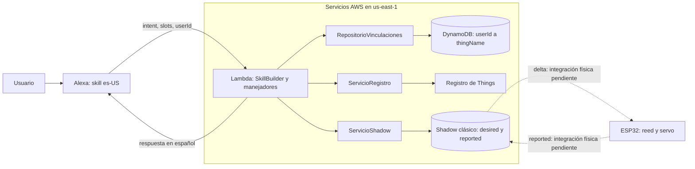

# Contribución de Mateo: backend Lambda y vinculaciones

Material para integrar con Lucía en `INFORME.md`, secciones 2.4, 2.5, 2.7,
3.2, 3.4, 4.2 y 4.8. Describe el código de esta rama y las verificaciones
locales de la auditoría final. Los diagramas representan el diseño y el flujo
previsto; no son evidencias de ejecución con dispositivos reales. La matriz de
requisitos, las evidencias pendientes y el procedimiento de entrega están en
[AUDITORIA_FINAL.md](AUDITORIA_FINAL.md); el texto para incorporar al informe
está en [APORTE_INFORME.md](APORTE_INFORME.md) y la defensa en
[GUIA_DEFENSA.md](GUIA_DEFENSA.md).

## Estado conocido y alcance de las evidencias

Mateo informó en esta conversación que la tabla, el rol, la Lambda Python
3.12 y el desencadenador Alexa Skills Kit están configurados, y que el backend
anterior a esta auditoría está empaquetado y desplegado. También informó que
Alexa vinculó la caja 1, consultó su estado y envió una orden de cierre, y que
`desired.cerradura` y `reported.cerradura` coincidieron en IoT Core.

Son **resultados reales comunicados por Mateo**, pendientes de adjuntar con
capturas, fecha y logs. No se especificó qué intent produjo la consulta de
estado, ni se inspeccionó la versión efectiva de la función en AWS. Esta
auditoría ejecutó **76 pruebas locales con mocks en Python 3.12.10**, sin
invocar servicios de AWS. Las 67 pruebas anteriores se conservaron.

**La prueba física con ESP32 y servomotor no se realizó.** La coincidencia de
`desired` y `reported` no demuestra un movimiento del servo ni identifica por
sí sola el origen del reporte. No se midieron tiempos ni se adjuntaron nuevas
evidencias experimentales en esta auditoría.

**Los cambios desplegables de la auditoría requieren un nuevo ZIP y una
actualización manual de AWS.** El ZIP anterior se conserva y ya no representa
el código local corregido. Las pruebas reales comunicadas corresponden al
backend anterior, no a las correcciones todavía sin desplegar.

## Arquitectura del backend



Los manejadores resuelven la caja del usuario en cada petición. El registro
IoT valida su existencia al vincular; DynamoDB conserva la relación entre
sesiones; el Shadow desacopla el comando de voz de su aplicación física.

## Diseño de clases de la Lambda

```mermaid
classDiagram
    class SkillBuilder
    class AbstractRequestHandler
    class AbstractExceptionHandler
    class LaunchRequestHandler
    class VincularCajaIntentHandler
    class DesvincularCajaIntentHandler
    class ConsultarTapaIntentHandler
    class ConsultarCerraduraIntentHandler
    class CambiarCerraduraIntentHandler
    class AbrirCerraduraIntentHandler
    class CerrarCerraduraIntentHandler
    class HelpIntentHandler
    class CancelOrStopIntentHandler
    class FallbackIntentHandler
    class NavigateHomeIntentHandler
    class SessionEndedRequestHandler
    class GlobalExceptionHandler
    class RepositorioVinculaciones {
        +obtener(user_id)
        +guardar(user_id, thing_name)
        +eliminar(user_id)
    }
    class ServicioRegistro {
        +existe_thing(thing_name)
    }
    class ServicioShadow {
        +leer_estado(thing_name)
        +leer_reported(thing_name)
        +pedir_cerradura(thing_name, estado)
    }
    AbstractRequestHandler <|-- LaunchRequestHandler
    AbstractRequestHandler <|-- VincularCajaIntentHandler
    AbstractRequestHandler <|-- DesvincularCajaIntentHandler
    AbstractRequestHandler <|-- ConsultarTapaIntentHandler
    AbstractRequestHandler <|-- ConsultarCerraduraIntentHandler
    AbstractRequestHandler <|-- CambiarCerraduraIntentHandler
    CambiarCerraduraIntentHandler <|-- AbrirCerraduraIntentHandler
    CambiarCerraduraIntentHandler <|-- CerrarCerraduraIntentHandler
    AbstractRequestHandler <|-- HelpIntentHandler
    AbstractRequestHandler <|-- CancelOrStopIntentHandler
    AbstractRequestHandler <|-- FallbackIntentHandler
    CancelOrStopIntentHandler <|-- NavigateHomeIntentHandler
    AbstractRequestHandler <|-- SessionEndedRequestHandler
    AbstractExceptionHandler <|-- GlobalExceptionHandler
    SkillBuilder o-- AbstractRequestHandler : registra instancias
    SkillBuilder o-- GlobalExceptionHandler : registra instancia
    LaunchRequestHandler --> RepositorioVinculaciones
    VincularCajaIntentHandler --> RepositorioVinculaciones
    VincularCajaIntentHandler --> ServicioRegistro
    VincularCajaIntentHandler --> ServicioShadow
    DesvincularCajaIntentHandler --> RepositorioVinculaciones
    ConsultarTapaIntentHandler --> RepositorioVinculaciones
    ConsultarTapaIntentHandler --> ServicioShadow
    ConsultarCerraduraIntentHandler --> RepositorioVinculaciones
    ConsultarCerraduraIntentHandler --> ServicioShadow
    CambiarCerraduraIntentHandler --> RepositorioVinculaciones
    CambiarCerraduraIntentHandler --> ServicioShadow
```



La función `crear_skill` de [lambda_function.py](lambda_function.py) compone
estos objetos. Cada manejador recibe sus servicios por constructor y cada
servicio recibe el cliente boto3 o la tabla. Esto permite reutilizar los
clientes en Lambda y sustituirlos por mocks durante las pruebas.
La clase común de comandos evita duplicar la resolución del usuario y la
escritura de `desired` entre apertura y cierre.
La función compartida `obtener_user_id`, en
[identidad.py](manejadores/identidad.py), maneja la ausencia de `context`,
`System`, `user` o un identificador vacío. No usa el usuario de `session` como
alternativa ni realiza consultas AWS sin identidad válida.

## Mecanismo de vinculación

La clave persistente es `context.System.user.userId`, no el identificador de
sesión ni una variable global. El
[repositorio](servicios/repositorio_vinculaciones.py) hace `GetItem` con
`ConsistentRead=True` para observar cambios recientes de vinculación.

`numeroCaja` se convierte en un entero entre 1 y 99; el nombre se construye
con el prefijo configurado y dos dígitos, por ejemplo `caja-enigmas-01`.
[VincularCajaIntentHandler](manejadores/vincular_caja.py) valida el formato
de los slots antes de llamar a AWS. Después comprueba `DescribeThing`; solo
si existe consulta el Shadow y compara el código ingresado con
`reported.codigoVinculacion`, que debe ser un **string**. El código ingresado
debe contener exactamente cuatro dígitos ASCII y conserva ceros iniciales. Un código
incorrecto, un Thing inexistente o un error de AWS no producen una nueva
vinculación.

La tabla `CajaEnigmasVinculaciones` usa partición `userId` (String), sin clave
de ordenación, y capacidad on-demand según la
[definición exportada](../config/aws/tabla-vinculaciones.json). Cada ítem
contiene `thingName` (String) y `fechaVinculacion` (String ISO-8601 UTC; el
código actual representa UTC con `+00:00`). `PutItem` reemplaza el ítem del
mismo usuario para cambiar de caja. `DeleteItem` lo elimina sin afectar a
otros usuarios. El contrato permite una caja por usuario y no establece
exclusividad de una caja entre usuarios distintos.

### Secuencia de vinculación

```mermaid
sequenceDiagram
    actor U as Usuario
    participant A as Alexa
    participant L as Lambda
    participant R as Registro IoT
    participant S as Shadow clásico
    participant D as DynamoDB
    U->>A: Vincula caja con número y código
    A->>L: VincularCajaIntent + slots + context.System.user.userId
    L->>L: Validar número, formato del código y construir thingName
    L->>R: DescribeThing(thingName)
    alt Thing inexistente
        R-->>L: ResourceNotFoundException
        L-->>A: La caja no existe; no guardar
    else Thing existente
        R-->>L: Thing válido
        L->>S: GetThingShadow(thingName)
        S-->>L: state.reported.codigoVinculacion
        L->>L: Verificar tipo string del código reportado y comparar
        alt Código incorrecto o ausente en reported
            L-->>A: Explicar el error; no guardar
        else Código correcto
            L->>D: PutItem(userId, thingName, fechaVinculacion)
            D-->>L: Vinculación persistida o reemplazada
            L-->>A: Confirmar vinculación
        end
    end
    A-->>U: Respuesta en español
```

### Secuencia de consulta del sensor

```mermaid
sequenceDiagram
    participant E as ESP32
    participant S as Shadow clásico
    actor U as Usuario
    participant A as Alexa
    participant L as Lambda
    participant D as DynamoDB
    Note over E,S: Flujo previsto de firmware; no ejecutado en estas pruebas
    E->>S: MQTT TLS update con reported.tapa
    U->>A: Consultar estado de la tapa
    A->>L: ConsultarTapaIntent + userId
    L->>D: GetItem(userId)
    D-->>L: thingName o ausencia de vinculación
    alt Sin vinculación
        L-->>A: Orientar para vincular
    else Usuario vinculado
        L->>S: GetThingShadow(thingName)
        S-->>L: state.reported.tapa
        L-->>A: Estado reportado o información no disponible
    end
    A-->>U: Respuesta en español
```

### Secuencia de un comando y su confirmación

```mermaid
sequenceDiagram
    actor U as Usuario
    participant A as Alexa
    participant L as Lambda
    participant D as DynamoDB
    participant S as Shadow clásico
    participant E as ESP32
    U->>A: Abre la cerradura
    A->>L: AbrirCerraduraIntent + userId
    L->>D: GetItem(userId)
    D-->>L: thingName vinculado
    L->>S: UpdateThingShadow con desired.cerradura = abierta
    S-->>L: Actualización aceptada
    L-->>A: Orden enviada, pendiente de confirmación física
    A-->>U: Respuesta de envío
    Note over S,E: Flujo previsto; puede demorarse si la caja está desconectada
    S-->>E: MQTT update/delta
    E->>E: Mover servo
    E->>S: MQTT update con reported.cerradura = abierta
    U->>A: Consulta la cerradura
    A->>L: ConsultarCerraduraIntent + userId
    L->>D: GetItem(userId)
    D-->>L: thingName
    L->>S: GetThingShadow(thingName)
    S-->>L: desired y reported de la misma lectura
    L-->>A: Estado reportado; avisar si la orden sigue pendiente
    A-->>U: Respuesta en español
```

La apertura y el cierre nunca llaman directamente al ESP32, no publican
mensajes MQTT desde Lambda y no escriben `reported`. Si la caja está
desconectada, `desired` puede permanecer pendiente. No se usa espera ni
sondeo para afirmar un movimiento. La consulta de cerradura informa el
último estado reportado y agrega una advertencia cuando un estado deseado
válido difiere de lo reportado, incluso si todavía no existe `reported`.
Si no hay estado reportado válido, lo dice sin inventarlo. Este diseño no
detecta conectividad ni mide la antigüedad del último reporte.

## Implementación y manejo de errores

[ServicioShadow](servicios/servicio_shadow.py) conserva `leer_reported` y
`pedir_cerradura`, y agrega `leer_estado`. Esta última obtiene juntas las
secciones `desired` y `reported`, evitando comparar lecturas de versiones
distintas. Los comandos validan los dos valores permitidos y envían solamente
`state.desired.cerradura` al Shadow clásico. El cliente retorna un payload
que el servicio consume como JSON y cierra; las interfaces corresponden a
[GetThingShadow](https://docs.aws.amazon.com/boto3/latest/reference/services/iot-data/client/get_thing_shadow.html)
y [UpdateThingShadow](https://docs.aws.amazon.com/boto3/latest/reference/services/iot-data/client/update_thing_shadow.html).

Los [manejadores de sesión](manejadores/sesion.py) implementan ayuda,
fallback, cancelación, parada y fin de sesión. Al recibir `SessionEndedRequest`
se devuelve una respuesta vacía, como requiere el
[SDK de Alexa](https://developer.amazon.com/en-US/docs/alexa/alexa-skills-kit-sdk-for-python/develop-your-first-skill.html).
Cancelar o parar cierra la conversación: no revierte una orden que ya haya
sido escrita en `desired`.

El [manejador global](manejadores/errores.py) recibe errores de los servicios
y del despacho. Devuelve una frase genérica y registra únicamente una
categoría y una operación conocidas. Un código u operación AWS desconocidos
se sustituyen por etiquetas fijas. No guarda eventos, identificadores de
usuario, slots, tokens, el mensaje de AWS ni tracebacks. Así permite
distinguir, por ejemplo, `AccessDeniedException` de `ResourceNotFoundException`
sin incorporar datos privados en el log propio. Las pruebas no inspeccionan
los logs reales de CloudWatch.

## Revisión de permisos y configuración

Revisión **estática**, basada en los archivos de `config/aws/`. No equivale a
una evaluación de permisos efectivos del rol en la cuenta. El usuario informó
que DynamoDB, el rol, las variables, la Lambda desplegada y el disparador ASK
están configurados; esa información no se presenta como una inspección nueva
de la cuenta. No hay herramientas `aws-mcp` disponibles y `aws` no aparece en
el PATH de esta sesión. No se leyó la configuración desplegada, la versión
invocada por Alexa ni las políticas efectivas. La configuración operativa
reportada y la falta de evidencia adjunta se distinguen en la auditoría final.

| Permisos en la política exportada | Recurso restringido | Uso en el código |
|---|---|---|
| `iot:DescribeThing` | Things `caja-enigmas-*`, cuenta del grupo, `us-east-1` | Validar existencia antes de vincular. |
| `iot:GetThingShadow` | Los mismos Things | Leer código, tapa, cerradura y orden pendiente. |
| `iot:UpdateThingShadow` | Los mismos Things | Solicitar apertura/cierre mediante `desired`. |
| `dynamodb:GetItem` | Tabla `CajaEnigmasVinculaciones`, cuenta del grupo, `us-east-1` | Resolver la caja del usuario. |
| `dynamodb:PutItem` | La misma tabla | Vincular o sustituir vinculación. |
| `dynamodb:DeleteItem` | La misma tabla | Desvincular. |

La [política exportada](../config/aws/politica-rol-lambda.json) incluye estas
seis acciones sin conceder acceso general a IoT ni a DynamoDB. Los ARN de IoT
usan el tipo de recurso `thing`, compatible con las acciones indicadas según
la [referencia de autorización de IoT](https://docs.aws.amazon.com/service-authorization/latest/reference/list_iot.html).
La separación entre usuarios depende de la resolución correcta de `userId`
en el backend, porque la función comparte un rol con acceso a las cajas del
grupo. No requiere `Scan`, `Query`, creación de recursos ni permisos MQTT de
`Publish`/`Connect`.

Los permisos de CloudWatch Logs **no aparecen en ese archivo**. El plan prevé
adjuntar por separado `AWSLambdaBasicExecutionRole`, que concede
`logs:CreateLogGroup`, `logs:CreateLogStream` y `logs:PutLogEvents`.
No se confirmó que esté adjunta. Ver la
[política administrada oficial](https://docs.aws.amazon.com/aws-managed-policy/latest/reference/AWSLambdaBasicExecutionRole.html).
En producción se pueden acotar los recursos de logs al grupo de esta función
y documentar cualquier permiso adicional del rol real.

### Comprobaciones que debe hacer una persona en la consola

1. En **Lambda**, región `us-east-1`, abrir `caja-enigmas-skill`. En Runtime
   settings, revisar Python 3.12, arquitectura y handler
   `lambda_function.lambda_handler`. No asumir que el código local ya está
   desplegado.
2. En **Configuration → Environment variables**, comprobar
   `TABLA_VINCULACIONES`, `PREFIJO_THING` e `IOT_ENDPOINT` contra los contratos.
   El endpoint requiere `https://` y debe ser el de datos ATS del grupo.
3. En **Configuration → Permissions**, abrir el rol real de ejecución.
   Revisar su confianza en `lambda.amazonaws.com`, las políticas adjuntas e
   inline, sus versiones activas y cualquier límite de permisos o denegación
   aplicable. Contrastar la política activa con el JSON exportado y comprobar
   el acceso a CloudWatch Logs. Toda corrección IAM se realiza a mano por el
   grupo, sin automatizarla desde este trabajo.
4. En **DynamoDB → Tables → CajaEnigmasVinculaciones**, comprobar partición
   `userId` String, ausencia de clave de ordenación y capacidad on-demand.
5. Con el **Skill ID de Lucía**, revisar en Lambda el disparador **Alexa Skills
   Kit** y activar la verificación del ID si falta. La política de recursos de
   la función debe permitir `lambda:InvokeFunction` al principal
   `alexa-appkit.amazon.com` con `lambda:EventSourceToken` igual al Skill ID.
   Esto es distinto del rol con el que Lambda accede a IoT/DynamoDB. La
   [guía oficial de integración](https://developer.amazon.com/en-US/docs/alexa/custom-skills/host-a-custom-skill-as-an-aws-lambda-function.html)
   explica la verificación en el disparador.
6. En **Alexa Developer Console → Build → Endpoint**, Lucía debe comprobar
   que el endpoint de América apunte al ARN exacto de esta función, versión o
   alias previsto. Si usa un alias, comprobar también su versión efectiva y
   sus permisos; el estado de `$LATEST` no prueba qué código invoca Alexa.
7. Lucía debe compilar el modelo **Spanish (US), es-US**, nombre de invocación
   **caja de enigmas**, con los seis intents propios y los integrados de los
   contratos. En `VincularCajaIntent`, exigir `numeroCaja` (`AMAZON.NUMBER`) y
   `codigo` (`AMAZON.FOUR_DIGIT_NUMBER`), con delegación automática del diálogo
   (`delegationStrategy: ALWAYS`). El manejador actual no devuelve
   `Dialog.Delegate`; si la delegación queda a cargo del backend, habría que
   coordinar e implementar ese flujo. Ver la
   [guía de delegación](https://developer.amazon.com/en-US/docs/alexa/custom-skills/delegate-dialog-to-alexa.html).
   Verificar por voz ceros iniciales y exportar el JSON del modelo a la ruta
   acordada.

No se modificaron IAM, la función, la tabla, el Shadow ni otros recursos de
AWS durante este trabajo. Las correcciones que surjan de estos pasos quedan
a cargo de una persona del grupo desde la consola.

## Validación local y trazabilidad

Se ejecutaron desde la raíz:

```powershell
py -3.12 -m unittest discover -s lambda/tests -v
py -3.12 -m compileall -q lambda/lambda_function.py lambda/textos.py lambda/manejadores lambda/servicios lambda/tests
```

Resultado final: **76 pruebas aprobadas**, manteniendo las **67 anteriores** y
agregando **9** de auditoría; compilación sintáctica sin errores. Se usó Python **3.12.10**
con `ask-sdk-core` **1.19.0**, `ask-sdk-model` **1.82.0**, `boto3` y `botocore`
**1.43.126**. También pasaron las 76 pruebas con las dependencias del paquete
Linux x86_64 local, aisladas de las bibliotecas globales. La ejecución de tests
es local en Windows; no se ejecutaron los binarios Linux en AWS.

[test_auditoria.py](tests/test_auditoria.py) añade regresiones para identidad
ausente o vacía, rechazo de un código reportado numérico, validación local
antes de consultar AWS, conservación de ceros iniciales, escape de texto
dinámico en SSML, orientación al desvincular sin caja y errores de red sin
exponer su mensaje. Estos fallos se reprodujeron antes de corregirlos; las
pruebas anteriores no se modificaron ni se eliminaron.

| RF | Cobertura del backend local | Pruebas relevantes |
|---|---|---|
| RF4 | Consulta de `reported.tapa` en español. | `test_consultar_tapa.py`, `test_flujos_skill.py` |
| RF5 | Apertura/cierre escriben solo `desired.cerradura` de la caja del usuario. | `test_cerradura.py`, `test_estado_shadow.py`, `test_flujos_skill.py` |
| RF6 | Estado reportado de cerradura y detección de órdenes pendientes. | `test_cerradura.py` |
| RF7 | Persistencia de la vinculación, código válido y ceros iniciales. | `test_vincular_caja.py`, `test_repositorio_vinculaciones.py`, `test_flujos_skill.py` |
| RF8 | Resolución en cada petición, usuario sin caja y aislamiento de dos usuarios. | `test_lanzamiento.py`, `test_consultar_tapa.py`, `test_cerradura.py`, `test_flujos_skill.py` |
| RF9 | Existencia del Thing, cambio de caja y desvinculación. | `test_servicio_registro.py`, `test_vincular_caja.py`, `test_desvincular_caja.py`, `test_flujos_skill.py` |

Los errores de AWS (IoT y las tres operaciones de DynamoDB), los estados
desconocidos o pendientes y los códigos incorrectos se simulan con mocks.
[test_sesion_y_errores.py](tests/test_sesion_y_errores.py) comprueba respuestas
de sesión y que los logs propios omitan datos privados. Los nuevos flujos
pasan por el `SkillBuilder`, el dispatcher y la serialización reales del SDK,
con servicios o clientes AWS sustituidos. Se crean solicitudes independientes
para demostrar que no se depende de la sesión de Alexa para la vinculación.

La suite valida la lógica local de RF4–RF9. Las pruebas reales comunicadas por
Mateo se describen al inicio y todavía requieren sus evidencias. Ni los mocks
ni la coincidencia observada en el Shadow demuestran RF1–RF3, movimiento del
servo, reconexión o requisitos no funcionales. No se midieron latencia de
extremo a extremo, estabilidad, exactitud ni frecuencia física de reporte.
El ZIP previo existe, pero no contiene estas correcciones: falta generar y
subir manualmente uno nuevo y repetir la regresión de Alexa.

## Incidencias y coordinación pendiente

- **Herramientas de revisión:** `aws` no aparece en el PATH y no hay
  herramientas `aws-mcp`. La revisión de permisos quedó limitada a los
  archivos exportados; los resultados reales son los comunicados por Mateo.
- **Runtime local:** Python 3.12.10 verificado con 76 pruebas. El SDK de Alexa
  emite `SyntaxWarning` por escapes en sus fuentes, sin impedir los tests.
  El procedimiento de empaquetado está en el
  [README](README.md#empaquetado-local-para-subir-manualmente).
- **Con Lucía:** el archivo `config/alexa/modelo-interaccion.es-US.json` no
  existe en esta rama al revisar. Exportarlo desde la consola y comprobar
  nombres, slots obligatorios, Skill ID, endpoint, respuestas y dos usuarios.
  La confirmación de desvinculación es opcional en el plan y no se implementó;
  si se desea, hay que coordinar su modelo de diálogo antes de añadirla.
- **Precisión del contrato de intents:** no se cambiaron sus nombres, slots
  ni estados. `AMAZON.NavigateHomeIntent` es un intent que Alexa procesa para
  salir en dispositivos con pantalla; no debe interpretarse como un regreso
  a la bienvenida de la skill. Se mantiene un cierre defensivo para eventos
  directos y Lucía debe tenerlo en cuenta al preparar las pruebas. Ver la
  [semántica oficial](https://developer.amazon.com/en-US/docs/alexa/custom-skills/standard-built-in-intents.html#amazon-navigatehomeintent).
- **Con Adrián y Santiago:** comprobar `reported.tapa`,
  `reported.cerradura`, el código real de cuatro dígitos, comandos sobre el
  servo y recuperación del `desired` pendiente al reconectar. Mantener los
  nombres, tipos y estados de los contratos.
- **Evidencias con el grupo:** tras actualizar manualmente el backend corregido, ejecutar con Lucía los
  casos de RF4–RF9 desde el simulador, incluidas dos cuentas/usuarios, código
  incorrecto, Thing inexistente, cambio, desvinculación y caja desconectada.
  Registrar resultados observados, capturas y errores reales sin secretos.
  La vinculación, consulta de estado y orden de cierre comunicadas ya son
  antecedentes reales; falta adjuntar capturas y logs y precisar el intent de
  consulta. Las mediciones físicas siguen pendientes. Ver la lista concreta
  de evidencias en [AUDITORIA_FINAL.md](AUDITORIA_FINAL.md).
